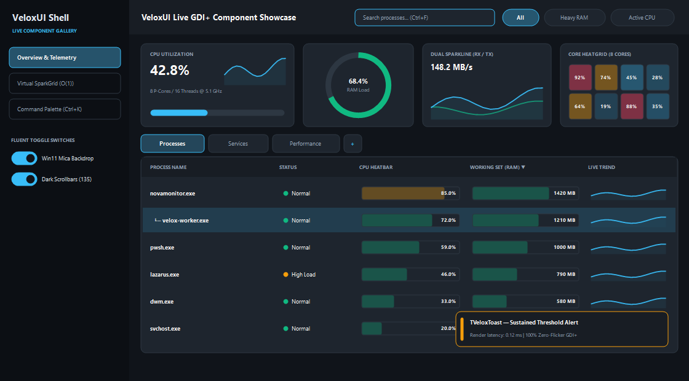
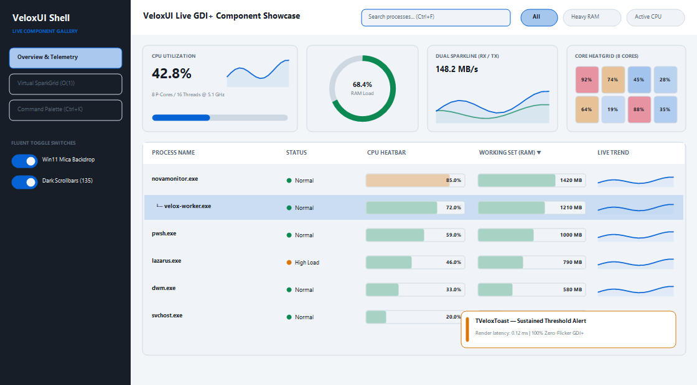
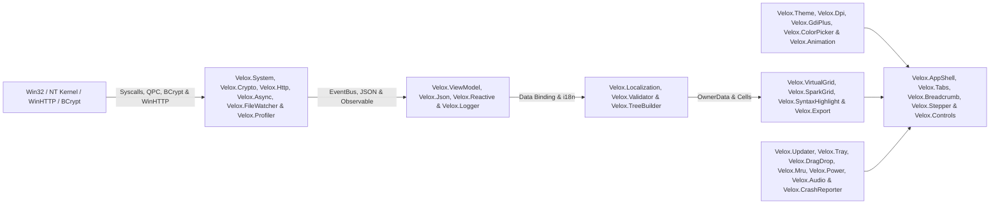
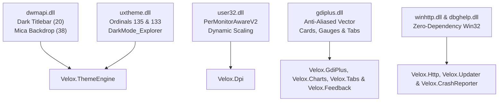

<p align="center">
  
</p>

<p align="center">
  <a href="#-50-framework-modules-7-core--43-expansion"></a>
  <a href="#-getting-started--installation"></a>
  <a href="#-before-vs-after-85-less-boilerplate"></a>
  <a href="#-automated-verification-suite-209209-passing"></a>
  <a href="#-17-hard-won-win32--vcl--lcl-gotchas-solved"></a>
  <a href="LICENSE"></a>
</p>

<p align="center">
  <strong>VeloxUI</strong> is a high-velocity, zero-dependency <strong>Object Pascal (Delphi VCL &amp; Lazarus / Free Pascal LCL)</strong> desktop UI and MVVM micro-framework. It distills every hard-won Win32, Windows 11 DWM (Mica/Acrylic/Dark Titlebar), undocumented <code>uxtheme.dll</code> dark scrollbar, Per-Monitor v2 High-DPI scaling, hardware-accelerated <code>GDI+</code> vector rendering, flicker-free virtual <code>TListView</code>, 60 FPS easing animation, two-way MVVM data-binding, WinHTTP networking, GitHub self-updater, runtime i18n, minidump crash reporting, BCrypt CNG cryptography, Win32 directory watching, zero-COM drag-and-drop, and NT Kernel pattern into <strong>50 drop-in units</strong>.
</p>

---

## 📸 Live GDI+ Component Showcase (`Dark` & `Light` Themes)

> Generated programmatically via [`TVeloxScreenshot.RenderComponentShowcase`](src/Velox.Screenshot.pas) using real hardware-accelerated `VeloxUI` GDI+ primitives ([`TVeloxAppShell`](src/Velox.AppShell.pas), [`TVeloxTabStrip`](src/Velox.Tabs.pas), [`TVeloxSearchBox`](src/Velox.Controls.pas), [`TVeloxToggleSwitch`](src/Velox.ToggleSwitch.pas), [`TVeloxChipGroup`](src/Velox.StyledButton.pas), [`TVeloxCharts`](src/Velox.Charts.pas), [`TVeloxSparkGrid`](src/Velox.SparkGrid.pas), and [`TVeloxToast`](src/Velox.Toast.pas)). All controls feature pixel-perfect vertical and horizontal text centering.

### Windows 11 Fluent Dark Mode (`vtDark`)
<p align="center">
  
</p>

### Windows 11 Fluent Daylight Mode (`vtLight`)
<p align="center">
  
</p>

---

## 🎯 Why VeloxUI Exists

Native Object Pascal (`Delphi` and `Free Pascal / Lazarus`) is one of the most productive secrets in systems software: it compiles in **~2 seconds** into a **~1.8 MB standalone native executable** that starts in **45 ms**, uses **~11 MB of RAM**, and requires **zero external runtime DLLs** (compared to 180+ MB and 300+ MB RAM for Electron/WebView2).

However, building a **modern Windows 11 Fluent Dark Mode** application in raw VCL/LCL traditionally forces developers to fight dozens of undocumented Win32 quirks:
- Native `TComboBox` controls ignore `.Height` and render taller than adjacent buttons at High-DPI.
- Standard bordered `TEdit` controls clip placeholder text against the top-left border with no vertical centering.
- Native `TCheckBox`, `TButton`, and `TSplitter` controls draw black-on-dark unreadable captions, glaring white Win32 bevels, or 1990s XOR stripes on dark panels.
- Standard `TListView` tables flash white on background erase, lose row selection on refresh, and show blinding white scrollbars in dark mode.
- Standard `MessageDlg` and `InputQuery` dialogs pop up blinding white legacy Win32 windows inside a dark-themed app.
- Standard GDI `Canvas.RoundRect` and `Canvas.Polyline` look jagged and aliased on modern High-DPI displays.

**VeloxUI solves all of these permanently.** Drop the `src/` folder into any Delphi or Lazarus project and build production-grade, flicker-free Windows 11 telemetry dashboards and desktop tools with **85% less code**.

---

## ⚡ Before vs. After: 85% Less Boilerplate

| Task | Raw Win32 / VCL / LCL Boilerplate | With **VeloxUI** |
| :--- | :---: | :---: |
| **1-Line Windows 11 Fluent App Shell (Sidebar + Header Search + Multi-Page Router + Tray)** | ~240 lines (Panels, anchors, page visibility loops, status bar) | **1 line** (`TVeloxAppShell.CreateShell(...)`) |
| **Vertically Centered Search Box with Focus Ring & `Esc` Clear** | ~65 lines (`TPanel` + `bsNone` `TEdit` + 4 event handlers) | **1 line** (`TVeloxSearchBox.CreateBox(...)`) |
| **High-DPI `TComboBox` Pixel-Matched to `TButton` Height** | ~45 lines (`CB_SETITEMHEIGHT` + `GetWindowRect` loop + `OnDrawItem`) | **1 line** (`TVeloxControls.SyncComboBoxHeight(...)`) |
| **Win11 Fluent Pill Toggle Switch (`On`/`Off` Thumb) & Flat GDI+ Slider** | ~140 lines (Custom control + mouse state + GDI+ pill & thumb math) | **1 line** (`TVeloxToggleSwitch.CreateSwitch(...)`) |
| **GDI+ Custom-Drawn Button & Mutual-Exclusion Filter Chip Bar** | ~150 lines (`TCustomControl` hover/press state machine + pill math) | **1 line** (`TVeloxChipGroup.CreateGroup(...)`) |
| **Win11 Dark Title Bar + Mica Backdrop + Dark Scrollbars + Recursive Theme** | ~120 lines (`dwmapi.dll` + `uxtheme.dll` ordinals `133`/`135` + tree walk) | **2 lines** (`ApplyFormTheme` + `ApplySystemBackdrop`) |
| **GDI+ Anti-Aliased KPI Card, Donut Gauge, Dual Sparkline & HeatGrid** | ~280 lines (GDI+ Flat API loader + arcs + polygon fill + grid math) | **1 line** (`DrawMetricCard` / `DrawDonutGauge` / `DrawHeatGrid`) |
| **Inline Grid Cell Heat-Bars, Mini Sparklines & Status Dots (`SparkGrid`)** | ~110 lines (Sub-rect clipping + severity blending + text alignment) | **1 line** (`TVeloxCellRenderer.DrawInlineBar(...)`) |
| **Flicker-Free Virtual `TListView` (`OwnerData` + QuickSort + `▲`/`▼` Arrows)** | ~160 lines (`LVS_EX_DOUBLEBUFFER` + QuickSort + UTF-8/UTF-16 arrows) | **4 lines** (`TVeloxVirtualGrid<T>.Create(...)`) |
| **VS Code / Raycast `Ctrl+K` Fuzzy-Search Command Palette** | ~210 lines (Subsequence scorer + owner-draw list + keyboard nav) | **2 lines** (`TVeloxCommandPalette` + `ShowPaletteModal`) |
| **Theme-Aware Fluent `Confirm` / `Alert` / `Prompt` TaskDialogs** | ~110 lines (Replaces blinding white `MessageDlg` & `InputQuery`) | **1 line** (`TVeloxTaskDialog.Confirm(...)`) |
| **Control / Form / Component Gallery PNG Screenshot Capture** | ~85 lines (`PaintTo` offscreen `pf24bit` `TBitmap` + `TPortableNetworkGraphic`) | **1 line** (`TVeloxScreenshot.CaptureControlToPng(...)`) |
| **Two-Way MVVM Control ↔ Observable Data Binding (`TEdit`, `ToggleSwitch`, `Slider`)** | ~120 lines (Re-entrancy guards + `OnChange` / subscriber wiring) | **1 line** (`Binder.BindEdit(Edit, Obs)` / `BindToggle(...)`) |
| **Zero-Dependency WinHTTP Client + GitHub Releases Self-Updater** | ~320 lines (`winhttp.dll` loader + JSON parser + SemVer + swap script) | **1 line** (`TVeloxUpdater.CheckLatest(...)`) |
| **Runtime JSON i18n Language Switcher with Live Control Re-Captioning** | ~130 lines (String tables + fallback lookup + control iteration) | **2 lines** (`Loc.Bind(Ctrl, Key)` + `Loc.SetLanguage('es')`) |
| **Global Crash Reporter + `dbghelp.dll` `.dmp` MiniDump Writer** | ~180 lines (`Application.OnException` + stack walk + `MiniDumpWriteDump`) | **1 line** (`CrashReporter.Install`) |

---

## 📦 50 Framework Modules (7 Core + 43 Expansion)

### Part I — 7 Core Foundation Modules

| # | Module | Key Classes | Purpose |
| :---: | :--- | :--- | :--- |
| **1** | [`src/Velox.Types.pas`](src/Velox.Types.pas) | `TVeloxThemeColors`, `TVeloxRingBuffer`, `TVeloxUtils` | Semantic Fluent Dark/Light palettes, `O(1)` zero-allocation circular ring buffer (`.Latest`, `.Average`, `.Peak`), cross-compiler UTF-8/UTF-16 glyphs (`▲`, `▼`, `└─`), and unit formatters (`FormatBytes`, `FormatMegabytes`, `FormatRateKBps`, `FormatDuration`). |
| **2** | [`src/Velox.Theme.pas`](src/Velox.Theme.pas) | `TVeloxThemeEngine` | Win10/11 Dark Title Bar (`DwmSetWindowAttribute` 20/19), Win11 22H2+ **Mica** / **Acrylic** Backdrops (`Attr 38`), undocumented `uxtheme.dll` ordinals `135`/`133` + `DarkMode_Explorer` dark scrollbars, and recursive `ApplyFormTheme`. |
| **3** | [`src/Velox.GdiPlus.pas`](src/Velox.GdiPlus.pas) | `TVeloxGdiPlus` | Dynamic `gdiplus.dll` Flat API vector engine: `DrawCard`, `DrawProgressBar`, `DrawBadge`, `DrawSparkline`, and 1-call `DrawMetricCard` with automatic font collision avoidance. |
| **4** | [`src/Velox.Controls.pas`](src/Velox.Controls.pas) | `TVeloxSearchBox`, `TVeloxDarkCheckBox`, `TVeloxControls` | Vertically centered borderless `TEdit` search wrapper, dark-panel safe checkbox, High-DPI `SyncComboBoxHeight` (`CB_SETITEMHEIGHT $0151` feedback loop), and 1-call `CreateModalDialog`. |
| **5** | [`src/Velox.VirtualGrid.pas`](src/Velox.VirtualGrid.pas) | `TVeloxVirtualGrid<T>` | Generic `OwnerData` virtual `TListView` controller with `LVS_EX_DOUBLEBUFFER`, natural initial sort direction (numeric columns sort **descending** first; text columns sort **ascending** first), `QuickSort`, and flicker-free `RefreshCount`. |
| **6** | [`src/Velox.Async.pas`](src/Velox.Async.pas) | `TVeloxPoller<T>`, `TVeloxThresholdAlert` | Generic background worker thread with `50ms` interruptible sleep slices (`<50ms` shutdown) + hysteresis/streak/cooldown threshold alert state machine. |
| **7** | [`src/Velox.System.pas`](src/Velox.System.pas) | `TVeloxSystem` | `NtQueryInformationProcess` (`Class 60`) command-line reader (`PROCESS_QUERY_LIMITED_INFORMATION`), `version.dll` digital publisher metadata, `GetGuiResources` GDI/USER handle counters, CPU affinity masks, `EmptyWorkingSet`, and `RunTask` UAC elevation. |

---

### Part II — 43 Expansion & Ecosystem Modules

| # | Module | Key Classes | Open-Source Inspiration & Capabilities |
| :---: | :--- | :--- | :--- |
| **8** | [`src/Velox.Export.pas`](src/Velox.Export.pas) | `TVeloxExporter` | Exports any dataset or virtual grid via `TVeloxCellProvider` to **RFC-4180 CSV**, **Structured JSON**, **GitHub Flavored Markdown (GFM)** tables, or the OS **Clipboard**. |
| **9** | [`src/Velox.Hotkeys.pas`](src/Velox.Hotkeys.pas) | `TVeloxHotkeyRegistry` | Declarative 1-line shortcut binding (`Bind`), `HandleKeyDown` dispatcher, and auto-generated **Keyboard Shortcuts Cheat Sheet** modal (`ShowCheatSheetModal`). |
| **10** | [`src/Velox.Config.pas`](src/Velox.Config.pas) | `TVeloxConfig` | Zero-dependency key/value & `TVeloxTheme` persistence with `CaptureFormBounds`, `RestoreFormBounds`, and multi-monitor `ClampToDesktop` off-screen rescue. |
| **11** | [`src/Velox.Charts.pas`](src/Velox.Charts.pas) | `TVeloxCharts` | Hardware-accelerated GDI+ `DrawDonutGauge` (`GdipDrawArc`), `DrawDualSparkline` (2-series overlapping area chart), and `DrawHeatGrid` (multi-cell core/block utilization heatmap). |
| **12** | [`src/Velox.Toast.pas`](src/Velox.Toast.pas) | `TVeloxToast` | Non-blocking floating GDI+ notification banner anchored to the bottom-right of any parent control (`ShowToast` / `Dismiss`) with auto-dismiss timer. |
| **13** | [`src/Velox.EventBus.pas`](src/Velox.EventBus.pas) | `TVeloxEventBus` | Inspired by [`spinettaro/delphi-event-bus`](https://github.com/spinettaro/delphi-event-bus). Thread-safe (`TCriticalSection`) Pub/Sub message bus with topic & wildcard `'*'` routing. |
| **14** | [`src/Velox.Reactive.pas`](src/Velox.Reactive.pas) | `TVeloxObservable<T>`, `TVeloxDebouncer` | Inspired by Grijjy MVVM & RxDelphi. Generic observable property with 1-line `BindLabel` live formatting + UI event rate-limiting debouncer (`Trigger`/`Flush`). |
| **15** | [`src/Velox.TreeBuilder.pas`](src/Velox.TreeBuilder.pas) | `TVeloxTreeBuilder<T>` | Inspired by [`JAM-Software/Virtual-TreeView`](https://github.com/JAM-Software/Virtual-TreeView). Generic `O(N)` flat-to-hierarchical DFS tree flattener with cycle protection and `FormatIndentedCaption` (`└─ `). |
| **16** | [`src/Velox.StyledButton.pas`](src/Velox.StyledButton.pas) | `TVeloxStyledButton`, `TVeloxChipGroup` | Inspired by [`EtheaDev/StyledComponents`](https://github.com/EtheaDev/StyledComponents). Custom-drawn GDI+ rounded buttons (`vsbSurface`, `vsbPrimary`, `vsbDanger`, `vsbOutline`) and mutual-exclusion segmented filter chip bars. |
| **17** | [`src/Velox.TaskDialog.pas`](src/Velox.TaskDialog.pas) | `TVeloxTaskDialog` | Dark/Light theme-aware Fluent replacement for `MessageDlg` and `InputQuery` (`Confirm`, `ConfirmEx` with dark-safe checkbox, `Alert`, `Prompt`, and headless `BuildDialog`). |
| **18** | [`src/Velox.CommandPalette.pas`](src/Velox.CommandPalette.pas) | `TVeloxCommandPalette` | VS Code / Raycast `Ctrl+K` fuzzy command palette with subsequence scoring (`FuzzyMatchScore`), `FilterCommands`, `ExecuteById`, and `ShowPaletteModal`. |
| **19** | [`src/Velox.AppShell.pas`](src/Velox.AppShell.pas) | `TVeloxAppShell` | Inspired by [`WPFLiteUI/LiteUI`](https://github.com/WPFLiteUI/LiteUI). 1-line Windows 11 Desktop Application Shell (`CreateShell`) with left navigation sidebar, header search bar, multi-page router (`AddPage`/`SwitchPage`), footer status bar, and `EnableTrayIcon`. |
| **20** | [`src/Velox.Logger.pas`](src/Velox.Logger.pas) | `TVeloxLogger` | Inspired by [`danieleteti/loggerpro`](https://github.com/danieleteti/loggerpro). Thread-safe circular ring-buffer logger (`DEBUG`, `INFO`, `WARN`, `ERROR`) with JSONL/Text export and `ShowLogViewerModal`. |
| **21** | [`src/Velox.Animation.pas`](src/Velox.Animation.pas) | `TVeloxAnimator` | Inspired by [`caesar2011/DelphiUIAnimation`](https://github.com/caesar2011/DelphiUIAnimation). 60 FPS property tweener (`StartIntTween`, `StartColorTween`) with `EaseOutQuad`, `EaseOutCubic`, `EaseInOutCubic`, and `EaseOutBack` curves. |
| **22** | [`src/Velox.ToggleSwitch.pas`](src/Velox.ToggleSwitch.pas) | `TVeloxToggleSwitch`, `TVeloxSlider` | Inspired by [`rareMaxim/FluentUI`](https://github.com/rareMaxim/FluentUI). Windows 11 Fluent pill Toggle Switch (`On`/`Off` thumb + caption) and flat GDI+ value slider (`0..100`). |
| **23** | [`src/Velox.ContextMenu.pas`](src/Velox.ContextMenu.pas) | `TVeloxPopupMenu` | Inspired by [`zamtmn/metadarkstyle`](https://github.com/zamtmn/metadarkstyle). Structured popup context menu builder with keyboard shortcut hints, severity tagging, and `ExecuteById`. |
| **24** | [`src/Velox.IPC.pas`](src/Velox.IPC.pas) | `TVeloxSingleInstance` | Inspired by [`Alexey-T/Lazarus-WinAPI-examples`](https://github.com/Alexey-T/Lazarus-WinAPI-examples). Win32 Named Mutex single-instance guard (`CreateMutexW`), `WM_COPYDATA` string IPC bridge, and `ActivateExistingWindow`. |
| **25** | [`src/Velox.SplitView.pas`](src/Velox.SplitView.pas) | `TVeloxSplitter` | Inspired by [`kryslt/KControls`](https://github.com/kryslt/KControls). Custom-painted GDI+ vertical splitter bar with accent grip pill, `MinSize`/`MaxSize` clamping, and double-click `ToggleCollapse`. |
| **26** | [`src/Velox.Profiler.pas`](src/Velox.Profiler.pas) | `TVeloxStopwatch`, `TVeloxFrameProfiler` | Inspired by [`Spring4D`](https://bitbucket.org/sglienke/spring4d). Hardware `QueryPerformanceCounter` microsecond timer + rolling `AverageMs`, `PeakMs`, and `P95Ms` frame latency tracker. |
| **27** | [`src/Velox.SparkGrid.pas`](src/Velox.SparkGrid.pas) | `TVeloxCellRenderer` | Inspired by [`winsiderss/systeminformer`](https://github.com/winsiderss/systeminformer). Renders inline proportional utilization heat-bars (`DrawInlineBar`), mini cell sparklines (`DrawInlineSparkline`), and status dots (`DrawStatusDotCell`). |
| **28** | [`src/Velox.Validator.pas`](src/Velox.Validator.pas) | `TVeloxValidator` | Inspired by [`danieleteti/delphimvcframework`](https://github.com/danieleteti/delphimvcframework). Declarative form input validator (`AddRequired`, `AddIntRange`, `AddFloatRange`, `AddCustom`, `ValidateAll`). |
| **29** | [`src/Velox.MarkdownView.pas`](src/Velox.MarkdownView.pas) | `TVeloxMarkdownView` | Native GDI+ Markdown & changelog control rendering `# H1`/`## H2`/`### H3` headings, bullet lists, callout quotes (`> `), and rules without WebView2. |
| **30** | [`src/Velox.Screenshot.pas`](src/Velox.Screenshot.pas) | `TVeloxScreenshot` | Captures any `TWinControl` / `TForm` (`CaptureControlToPng`) to PNG and generates live GDI+ component showcase galleries (`RenderComponentShowcase`) for docs and visual regression testing. |
| **31** | [`src/Velox.Json.pas`](src/Velox.Json.pas) | `TVeloxJson` | Inspired by [`ahausladen/JsonDataObjects`](https://github.com/ahausladen/JsonDataObjects) & [`neslib/Neslib.Json`](https://github.com/neslib/Neslib.Json). Zero-dependency RFC-8259 JSON parser & fluent builder DOM with dotted/indexed `Path('assets[0].name')` navigation, typed accessors (`AsString`/`AsInt`/`AsFloat`/`AsBool`), and compact/pretty serialization. |
| **32** | [`src/Velox.Http.pas`](src/Velox.Http.pas) | `TVeloxHttp` | Zero-dependency HTTP/HTTPS client built directly on Win32 `winhttp.dll` (OS TLS + system proxy, zero OpenSSL/Indy DLLs): `ParseUrl`, `Request`, `Get`, `PostJson`, `DownloadToFile` with progress/cancel, and `RequestAsync`. |
| **33** | [`src/Velox.Updater.pas`](src/Velox.Updater.pas) | `TVeloxUpdater` | Self-updater powered by the GitHub Releases API (`Velox.Http` + `Velox.Json`): SemVer `CompareVersions` (including `-prerelease`), `ParseRelease`, `CheckLatest`, `DownloadUpdate`, `BuildSwapScript`, and `ApplyUpdateAndRestart`. |
| **34** | [`src/Velox.Localization.pas`](src/Velox.Localization.pas) | `TVeloxLocalizer` | Inspired by `dxgettext` / LCL `.po` workflows without external tools. Runtime multi-language string tables (`AddLanguageFromJson`), fallback language resolution, `Tr` / `TrF`, and `Bind(Control, Key)` live control re-captioning on `SetLanguage`. |
| **35** | [`src/Velox.Dpi.pas`](src/Velox.Dpi.pas) | `TVeloxDpi` | Per-Monitor-V2 High-DPI engine (`EnablePerMonitorV2`, `GetSystemDpi`, `GetWindowDpi`, `GetScaleFactor`, `Scale`/`Unscale`, `ScaleControlTree`, and `RescaleForm` for `WM_DPICHANGED`). |
| **36** | [`src/Velox.ViewModel.pas`](src/Velox.ViewModel.pas) | `TVeloxViewModel`, `TVeloxBinder` | Inspired by Grijjy MVVM & Spring4D data binding. Property-changed notification base class with `BeginUpdate`/`EndUpdate` batching & dirty tracking + two-way loop-guarded control binder (`BindEdit`, `BindCheckBox`, `BindToggle`, `BindSlider`, `BindVisible`, `BindEnabled`). |
| **37** | [`src/Velox.Tray.pas`](src/Velox.Tray.pas) | `TVeloxTray` | Themed system-tray manager with severity balloon notifications, dynamic 16×16 GDI+ live telemetry badge icon (`RenderBadgeBitmap` / `SetBadge`), Win11 bottom-right quick-settings flyout (`BuildFlyout`/`ShowFlyout`), and `HideToTray`/`RestoreFromTray`. |
| **38** | [`src/Velox.Feedback.pas`](src/Velox.Feedback.pas) | `TVeloxInfoBar`, `TVeloxProgressRing`, `TVeloxSkeleton` | Inspired by [`microsoft/microsoft-ui-xaml`](https://github.com/microsoft/microsoft-ui-xaml) WinUI 3 controls. Inline severity `TVeloxInfoBar` with close hit-test, determinate/indeterminate `TVeloxProgressRing`, and shimmering `TVeloxSkeleton` placeholders. |
| **39** | [`src/Velox.CrashReporter.pas`](src/Velox.CrashReporter.pas) | `TVeloxCrashReporter` | Inspired by `JclDebug` / `madExcept`. Hooks `Application.OnException`, captures call-stack frames (`CaptureStackTrace`) + `TVeloxLogger` ring-buffer history (`BuildReport`), writes a native `.dmp` minidump via `dbghelp.dll` (`MiniDumpWriteDump`), and displays a themed crash modal. |
| **40** | [`src/Velox.Tabs.pas`](src/Velox.Tabs.pas) | `TVeloxTabStrip` | Edge / Windows Terminal style GDI+ tab strip with selected accent indicator, per-tab close button (`vthClose`), trailing `+` button (`vthAdd`), drag-to-reorder (`MoveTab`), and mouse-wheel overflow scrolling. |
| **41** | [`src/Velox.Crypto.pas`](src/Velox.Crypto.pas) | `TVeloxCrypto` | Inspired by Windows CNG & `DCPcrypt`. Zero-dependency cryptographic hashing via Win32 `bcrypt.dll` (`Sha256`, `Sha1`, `Md5`), 64 KB chunked streaming file hashing (`HashFile`), IEEE 802.3 `Crc32`, and RFC-4648 `Base64Encode`/`Base64Decode`. |
| **42** | [`src/Velox.FileWatcher.pas`](src/Velox.FileWatcher.pas) | `TVeloxFileWatcher` | Inspired by `pyscripter/FileSystemMonitor`. Non-blocking background directory and file modification monitor built directly on Win32 `ReadDirectoryChangesW` with interruptible worker thread, debouncing, and main-thread event dispatch (`OnChanged`, `OnCreated`, `OnDeleted`, `OnRenamed`). |
| **43** | [`src/Velox.DragDrop.pas`](src/Velox.DragDrop.pas) | `TVeloxDropTarget` | Inspired by `The-Drag-and-Drop-Component-Suite-for-Delphi`. Lightweight zero-COM Win32 Shell file drag-and-drop target via `shell32.dll` (`DragAcceptFiles`, `DragQueryFileW`, `DragFinish`, `WM_DROPFILES`) with clean window subclassing (`TVeloxDropTarget.Register(Control, OnDrop)`). |
| **44** | [`src/Velox.Breadcrumb.pas`](src/Velox.Breadcrumb.pas) | `TVeloxBreadcrumb` | Windows 11 Explorer-style breadcrumb path navigation control with clickable segments, subtle chevrons (`›`), hover highlights, active leaf styling, and testable `HitTest`. |
| **45** | [`src/Velox.Mru.pas`](src/Velox.Mru.pas) | `TVeloxMru` | Inspired by `TJvMRUManager` and Windows Recent Documents. Persistent Most-Recently-Used history manager with capacity limits, deduplication, item pinning, auto-pruning of deleted files, JSON persistence, and automatic `TVeloxPopupMenu` sync with accelerators (`&1`). |
| **46** | [`src/Velox.ColorPicker.pas`](src/Velox.ColorPicker.pas) | `TVeloxColorPicker`, `TVeloxColorUtils` | Inspired by `jackdp/Free-Color-Picker` and Fluent UI. Fluent dark-theme color picker card with 16 swatches, hex preview (`#38bdf8`), and headless color conversions (`ColorToHex`, `HexToColor`, `RgbToHsv`, `HsvToRgb`). |
| **47** | [`src/Velox.SyntaxHighlight.pas`](src/Velox.SyntaxHighlight.pas) | `TVeloxCodeViewer`, `TVeloxLexer` | Inspired by `TurboPack/SynEdit` & Prism.js. Ultra-lightweight multi-language regex-free micro-lexer and dark-theme code viewer for JSON, SQL, Pascal, and Python with line numbers and hardware-accelerated Canvas rendering. |
| **48** | [`src/Velox.Stepper.pas`](src/Velox.Stepper.pas) | `TVeloxStepper` | Windows 11 Fluent multi-step setup wizard & pipeline progress indicator with step circles, states (`vssPending`, `vssActive`, `vssCompleted`, `vssError`), titles/subtitles, track connectors, and `NextStep`/`PrevStep`. |
| **49** | [`src/Velox.Power.pas`](src/Velox.Power.pas) | `TVeloxPower` | Hardware battery, power source, and sleep/resume telemetry via Win32 `GetSystemPowerStatus` (`IsOnAcPower`, `BatteryPercent`, `IsCharging`, `IsBatterySaverActive`, and `FormatRemainingTime`). |
| **50** | [`src/Velox.Audio.pas`](src/Velox.Audio.pas) | `TVeloxAudio` | Low-latency system telemetry chimes (`SuccessChime`, `ErrorChime`, `WarningChime`, `InfoChime`), asynchronous WAV player via `winmm.dll` `PlaySoundW`, and hardware frequency tone synthesis via Win32 `Tone(Freq, Duration)`. |

---

## 🏗 Compact Architecture Diagrams

### 1. High-Level Layer Flow (50 Modules)



### 2. Win11 Dark Mode, High-DPI & GDI+ Pipeline



---

## 🧠 17 Hard-Won Win32 / VCL / LCL Gotchas Solved

| # | The Win32 / Delphi / Lazarus Trap | Root Cause | How **VeloxUI** Solves It Automatically |
| :---: | :--- | :--- | :--- |
| **1** | **`TComboBox` ignores `.Height`** and renders too tall or too short next to `TButton` at High-DPI | Win32 `ComboBox` computes its outer height from `CB_SETITEMHEIGHT ($0151) + 2*SM_CYEDGE` instead of `WM_SIZE` | [`TVeloxControls.SyncComboBoxHeight`](src/Velox.Controls.pas) measures the reference button via `GetWindowRect` and runs a 2-pass `CB_SETITEMHEIGHT` feedback loop |
| **2** | **`TEdit` placeholder & text are pinned to the top-left border** with no vertical centering | Standard Win32 single-line edit controls do not support vertical internal padding | [`TVeloxSearchBox`](src/Velox.Controls.pas) wraps a borderless `bsNone` `TEdit` at exact vertical center inside a custom-painted `TPanel` with `10px` left margin |
| **3** | **`TCheckBox` caption renders black-on-dark** and is invisible on dark panels | Windows `UXTheme` overrides `TCheckBox` text color when themes are enabled | [`TVeloxDarkCheckBox`](src/Velox.Controls.pas) and [`TVeloxToggleSwitch`](src/Velox.ToggleSwitch.pas) decouple native caption rendering with vertical centering |
| **4** | **`TListView` flashes white on update** and loses selected row / scroll position | Assigning `Items.Count` unconditionally triggers `WM_ERASEBKGND` and resets viewport state | [`TVeloxVirtualGrid<T>`](src/Velox.VirtualGrid.pas) enables `LVS_EX_DOUBLEBUFFER ($10000)` and only updates `Items.Count` when the count changes, calling `Invalidate` otherwise |
| **5** | **`TListView` and `TMemo` show bright white scrollbars** in dark mode | Win32 common controls default to the light `"Explorer"` theme unless opted in via undocumented `uxtheme.dll` ordinals | [`TVeloxThemeEngine`](src/Velox.Theme.pas) invokes `uxtheme.dll` Ordinal `135` (`SetPreferredAppMode`), Ordinal `133` (`AllowDarkModeForWindow`), and `SetWindowTheme('DarkMode_Explorer', nil)` |
| **6** | **Compile Error on `Rect(0, 0, W, H)`** (`Incompatible types: got "RECT" expected "TRect"`) | Putting `Windows` after `Types` in `uses` causes the `Windows.RECT` struct to shadow `Types.Rect()` function | All VeloxUI units enforce `Windows` **before** `Types` in `uses` |
| **7** | **Compile Error on `GetEnvironmentVariable` / `DeleteFile`** (`Wrong number of parameters` / `PChar`) | `Windows.GetEnvironmentVariable` and `Windows.DeleteFile` shadow `SysUtils` overloads | Always qualify `SysUtils.GetEnvironmentVariable` and `SysUtils.DeleteFile` when `Windows` is in `uses` |
| **8** | **Compile Error on `odSelected in State`** in `OnDrawItem` under Lazarus/FPC | `Types` defines a conflicting `TOwnerDrawState`; LCL requires `LCLType` after `Types` | [`Velox.Controls.pas`](src/Velox.Controls.pas) and [`Velox.CommandPalette.pas`](src/Velox.CommandPalette.pas) include `{$IFDEF FPC} LCLType, {$ENDIF}` immediately after `Types` |
| **9** | **FPC 3.2.2 Error `(3339)`**: `Global Generic template references static symtable` | Free Pascal generic classes cannot reference constants declared in the `implementation` global scope | [`Velox.VirtualGrid.pas`](src/Velox.VirtualGrid.pas) and [`Velox.TreeBuilder.pas`](src/Velox.TreeBuilder.pas) scope constants locally inside generic methods or in `interface` |
| **10** | **FPC 3.2.2 `TThread.Queue` incompatibility** with anonymous closures | FPC 3.2.2 `TThread.Queue` expects a `TThreadMethod` (`procedure of object`) | [`TVeloxWorkerThread<T>`](src/Velox.Async.pas) uses a typed `FPendingData: T` field and `Queue(SyncDeliver)` method |
| **11** | **Corrupted `▲`/`▼` sort arrows (Mojibake)** between Delphi and Lazarus | Lazarus LCL strings are UTF-8 while Delphi VCL strings are UTF-16 | [`Velox.Types.pas`](src/Velox.Types.pas) defines `VELOX_ARROW_ASC` / `VELOX_ARROW_DESC` using `#$E2#$96#$B2` on FPC and `#$25B2` on Delphi |
| **12** | **`OpenProcess(PROCESS_VM_READ)` fails with Access Denied** when reading process command lines | Reading another process's PEB directly requires `PROCESS_VM_READ` | [`TVeloxSystem.GetProcessCommandLine`](src/Velox.System.pas) queries `NtQueryInformationProcess` Class `60` (`ProcessCommandLineInformation`), which only requires `PROCESS_QUERY_LIMITED_INFORMATION ($1000)` |
| **13** | **Indy / OpenSSL DLL Hell for HTTPS & REST** on client machines | Distributing `libeay32.dll` / `ssleay32.dll` causes version mismatches and anti-virus flags | [`Velox.Http.pas`](src/Velox.Http.pas) calls Win32 `winhttp.dll` directly: OS TLS certificates and system proxy are automatic with zero external DLLs |
| **14** | **Per-Monitor v2 High-DPI (`WM_DPICHANGED`) Font & Layout Desync** | Moving forms across monitors with different scaling scales child control bounds but leaves fonts or anchored children clipped | [`Velox.Dpi.pas`](src/Velox.Dpi.pas) provides `RescaleForm` + `ScaleControlTree` using `TControlAccess` to rescale custom fonts via `MulDiv` without triggering recursive `ParentFont` resets |
| **15** | **Unhandled Exception Crashes with Blank Error Dialogs** | Standard `ShowException` shows a brief message and loses the call stack and recent telemetry history | [`Velox.CrashReporter.pas`](src/Velox.CrashReporter.pas) captures stack frames via `BackTraceStrFunc`, flushes `TVeloxLogger` ring buffers, writes a native `.dmp` minidump via `dbghelp.dll`, and renders a dark-mode modal |
| **16** | **Stack Deallocation of `PWideChar` when wrapping Windows API String Constants** | Expressions like `PWideChar(WideString('Literal'))` construct temporary stack variables destroyed immediately after the call | Declare typed constants (`const BCRYPT_ALG: UnicodeString = '...';`) in [`Velox.Crypto.pas`](src/Velox.Crypto.pas) and [`Velox.Theme.pas`](src/Velox.Theme.pas) for permanent static string pointers |
| **17** | **Headless LCL Tests Crash with `Error 1407: Cannot find window class`** | Accessing `Canvas.TextWidth` or `Handle` on unparented/unshown controls in non-GUI test suites forces immediate win32 handle creation | [`Velox.Breadcrumb.pas`](src/Velox.Breadcrumb.pas) and [`Velox.Tabs.pas`](src/Velox.Tabs.pas) check `HandleAllocated` and compute character bounds arithmetically when headless |

---

## 🧪 Automated Verification Suite (`209/209 Passing`)

VeloxUI includes a self-contained console verification suite ([`tests/veloxtest.lpr`](tests/veloxtest.lpr)) that tests all **50 modules** headlessly and regenerates the Dark/Light component gallery PNGs in ~2.8 seconds:

```powershell
# Compile and run the 209-assertion verification suite with Lazarus / Free Pascal
lazbuild -B tests\veloxtest.lpi
.\tests\lib\veloxtest.exe
```

| Test Suite Section | Assertions | What Is Verified |
| :--- | :---: | :--- |
| **`[1/50]` RingBuffer & Utils** | `15` | Circular capacity cap, oldest eviction, `.Latest`/`.Peak`/`.Average`, Dark/Light token palettes, `BlendColor`, `FormatBytes`/`MB`/`KBps`/`Percent`/`Duration`, UTF-8/UTF-16 arrows |
| **`[2/50]` GDI+ Vector Engine** | `4` | Hardware-accelerated `DrawCard`, `DrawProgressBar`, `DrawBadge`, and `DrawSparkline` on offscreen bitmaps |
| **`[3/50]` DWM & UXTheme Engine** | `2` | Process-wide `InitializeProcessDarkMode` (Ordinal 135) and OS registry `DetectSystemTheme` |
| **`[4/50]` Fluent Controls & Modals** | `12` | `TVeloxSearchBox` 28px wrapper, `bsNone`, `Top=6` vertical centering, `Left=10` margin; `TVeloxDarkCheckBox` caption decoupling; `SyncComboBoxHeight`; `ApplyFormTheme`; `CreateModalDialog` |
| **`[5/50]` Generic VirtualGrid** | `9` | Automatic `OwnerData`, column registration, numeric column defaulting to **descending** on first click, text column defaulting to **ascending** on first click, QuickSort ordering, header arrows, `RefreshCount` |
| **`[6/50]` Async Poller & Alerts** | `9` | Sustained streak gating (`2/2`), immediate escalation to `vsCritical`, hysteresis recovery margin, live `SetInterval`, and `<50ms` interruptible thread shutdown |
| **`[7/50]` Win32 & NT System** | `8` | `NtQueryInformationProcess(60)` command-line extraction, `PID 0` guard, `version.dll` Microsoft publisher metadata on `kernel32.dll`, `GetGuiResources`, CPU affinity masks, `EmptyWorkingSet`, and `RunTask` guards |
| **`[8/50]` Universal Exporter** | `5` | RFC-4180 CSV field quoting, JSON escaping, `BuildCsvTable`, `BuildJsonTable`, and GFM `BuildMarkdownTable` pipe escaping |
| **`[9/50]` Declarative Hotkeys** | `3` | Shortcut registration, `HandleKeyDown` key interception (`Ctrl+F`), and `GenerateCheatSheet` output |
| **`[10/50]` Config & Bounds Clamp** | `6` | INI key/value persistence (`String`, `Int`, `Bool`, `Theme`) and `ClampToDesktop` off-screen monitor rescue |
| **`[11/50]` Advanced GDI+ Charts** | `3` | `DrawDonutGauge`, `DrawDualSparkline`, and multi-cell `DrawHeatGrid` rendering |
| **`[12/50]` Floating Toast Banner** | `2` | Non-blocking `ShowToast` visibility/severity state and `Dismiss` lifecycle |
| **`[13/50]` Thread-Safe EventBus** | `4` | Topic subscription, wildcard `'*'` routing, synchronous `Publish` delivery count, and `Unsubscribe` |
| **`[14/50]` Reactive Observable & Debouncer** | `4` | `TVeloxObservable<T>.BindLabel` live caption formatting, subscriber notification, and `TVeloxDebouncer` `Trigger`/`Flush` coalescing |
| **`[15/50]` Generic TreeBuilder** | `2` | `O(N)` DFS hierarchy flattening (`root -> child -> grandchild` depths `0, 1, 2`) and `FormatIndentedCaption` (`└─ `) |
| **`[16/50]` StyledButton & ChipGroup** | `3` | `TVeloxStyledButton` custom variant creation and `TVeloxChipGroup` mutual-exclusion chip switching |
| **`[17/50]` Fluent TaskDialog** | `1` | Headless `BuildDialog` verification of themed `BodyLabel`, `InputEdit`, and `TVeloxDarkCheckBox` |
| **`[18/50]` Fuzzy Command Palette** | `4` | Command registration, subsequence `FuzzyMatchScore`, ranked `FilterCommands`, and `ExecuteById` callback invocation |
| **`[19/50]` Win11 Desktop AppShell** | `4` | `CreateShell` scaffolding, `AddPage`/`SwitchPage` multi-page routing, `SetStatusMessage`, and `ApplyColors` live theme switching |
| **`[20/50]` Structured Ring Logger** | `3` | `Info`/`Warn`/`Error` ring buffering, `FormatAsText`, and `FormatAsJsonLines` (`.jsonl`) output |
| **`[21/50]` 60 FPS Easing Animator** | `4` | `EvaluateEasing` boundary conditions, `LerpInt`, `StartIntTween`, and `CompleteImmediately` |
| **`[22/50]` ToggleSwitch & Slider** | `3` | `TVeloxToggleSwitch` state & `OnToggle` callback, plus `TVeloxSlider` range clamping |
| **`[23/50]` Dark Popup ContextMenu** | `2` | `TVeloxPopupMenu` item registration and `ExecuteById` dispatch |
| **`[24/50]` Single-Instance & IPC** | `2` | Win32 Named Mutex primary acquisition and secondary instance collision detection (`IsPrimaryInstance = False`) |
| **`[25/50]` Fluent SplitView** | `3` | `TVeloxSplitter` minimum width clamping (`MinSize = 160`) and `ToggleCollapse` hide/restore cycle |
| **`[26/50]` QPC Stopwatch & Profiler** | `2` | Hardware `QueryPerformanceCounter` microsecond measurement and `TVeloxFrameProfiler` `PeakMs`/`P95Ms` |
| **`[27/50]` Inline SparkGrid Cells** | `3` | `DrawInlineBar`, `DrawInlineSparkline`, and `DrawStatusDotCell` rendering |
| **`[28/50]` Declarative Validator** | `2` | `AddRequired` and `AddIntRange` rejection of out-of-range input and acceptance of valid input |
| **`[29/50]` Native GDI+ MarkdownView** | `2` | Multi-block Markdown parsing and heading/bold token stripping |
| **`[30/50]` Screenshot & Gallery PNG** | `2` | `RenderComponentShowcase` live PNG generation for both `vtDark` and `vtLight` themes |
| **`[31/50]` RFC-8259 JSON DOM & Builder** | `5` | `TVeloxJson.Parse`, `Find`, dotted/indexed `Path('assets[0].name')`, and `NewObject` + `Serialize` roundtrip |
| **`[32/50]` WinHTTP Client** | `3` | `TVeloxHttp.ParseUrl` HTTPS/HTTP host, port, path parsing, and scheme validation |
| **`[33/50]` GitHub Releases Self-Updater** | `5` | SemVer `CompareVersions` (including `-beta` prereleases), `ParseRelease` asset selection, and `BuildSwapScript` |
| **`[34/50]` Runtime i18n Localizer** | `5` | `AddLanguageFromJson`, `Bind` live control re-captioning on `SetLanguage`, fallback lookup, and `TrF` |
| **`[35/50]` Per-Monitor v2 High-DPI** | `4` | `GetSystemDpi`, `GetScaleFactor`, `Scale`/`Unscale`, and recursive `ScaleControlTree` (`96 -> 144 DPI`) |
| **`[36/50]` Two-Way MVVM ViewModel & Binder** | `7` | `BeginUpdate`/`EndUpdate` property coalescing, `IsDirty`/`ClearDirty`, two-way `BindEdit`, and `BindToggle` |
| **`[37/50]` System Tray, Badge & Flyout** | `3` | 16×16 GDI+ `RenderBadgeBitmap`, bottom-right `CalcFlyoutPos`, and borderless `BuildFlyout` |
| **`[38/50]` WinUI Feedback Controls** | `4` | `TVeloxInfoBar` close hit-testing & `Dismiss`, `TVeloxProgressRing.Step`, and `TVeloxSkeleton.Step` shimmer |
| **`[39/50]` Crash Reporter & MiniDump** | `5` | `Install`/`Uninstall` exception hook, `BuildReport`, `CaptureStackTrace`, and `dbghelp.dll` `WriteMiniDump` |
| **`[40/50]` Fluent Tab Strip** | `6` | `AddTab`, `HitTest` (`vthTab`, `vthClose`, `vthAdd`), `MoveTab` reorder with selection tracking, and `RemoveTab` |
| **`[41/50]` BCrypt CNG Crypto & Hashing** | `5` | NIST test vectors for `Sha256`, `Sha1`, `Md5`, IEEE 802.3 `Crc32`, and RFC-4648 `Base64` roundtrip |
| **`[42/50]` Non-blocking File Watcher** | `3` | Win32 `ReadDirectoryChangesW` thread monitor, directory assignment, `Start`, and `<50ms` clean `Stop` |
| **`[43/50]` Win32 Shell File Drag & Drop** | `2` | Zero-COM `TVeloxDropTarget.Register` subclassing and clean `Unregister` |
| **`[44/50]` Explorer Breadcrumb Navigation** | `4` | Segment registration, key/caption preservation, segment `0` left edge `HitTest`, and `Clear` |
| **`[45/50]` Most-Recently-Used Manager** | `5` | Deduplication with top promotion, pinning, JSON `SaveToFile`, and `LoadFromFile` restoration |
| **`[46/50]` Fluent Color Picker & Swatches** | `4` | Hex roundtrip, pure red `RgbToHsv` (`H=0, S=1, V=1`), initial selected color, and swatch mutation |
| **`[47/50]` Micro-Lexer & Code Viewer** | `2` | Pascal line tokenization (keyword, identifier, comment) and `TVeloxCodeViewer` 4-line storage |
| **`[48/50]` Wizard & Stepper Control** | `3` | 3-step registration with initial active state, `NextStep` transition to `vssCompleted`/`vssActive`, and custom `StepState` assignment |
| **`[49/50]` Hardware Power & Battery** | `3` | Win32 `GetSystemPowerStatus` diagnostic description, `FormatRemainingTime` scaling, and `IsOnAcPower` boolean query |
| **`[50/50]` Telemetry Audio & Tone Synthesizer** | `3` | Hardware frequency `Tone` generation via Win32 `Beep`, `StopAll` execution, and non-existent WAV guard |

---

## 🚀 Getting Started & Installation

### 1. Clone the Repository
```powershell
git clone https://github.com/amafjarkasi/velox-ui.git
```

### 2. Add to Lazarus (`LCL`) or Delphi (`VCL`)
- **Lazarus**: In **Project → Project Options → Compiler Options → Paths**, add `..\velox-ui\src` to **Other unit files (`-Fu`)**.
- **Delphi**: In **Project → Options → Delphi Compiler → Search path**, add `..\velox-ui\src`.

### 3. Check Out the Complete Quick-Start Example
See [`examples/QuickStartDashboard.pas`](examples/QuickStartDashboard.pas) for a complete, ready-to-run Windows 11 Dark Mode telemetry dashboard.

---

## 📄 License

Released under the [MIT License](LICENSE).
