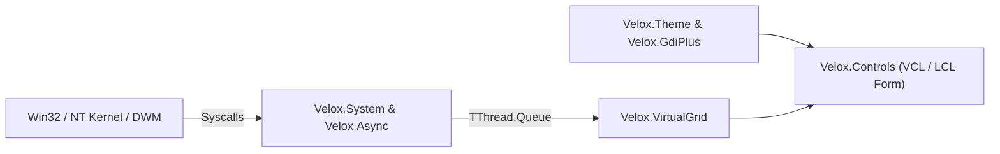
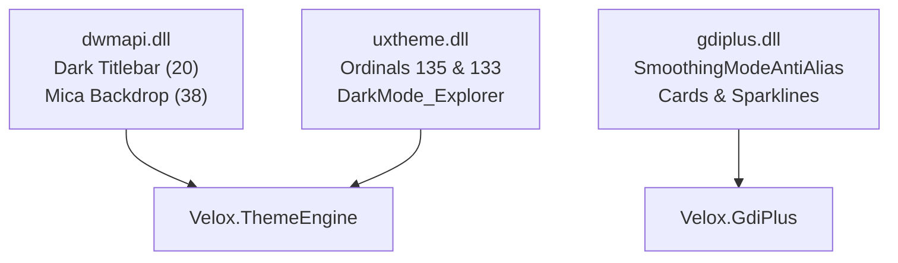
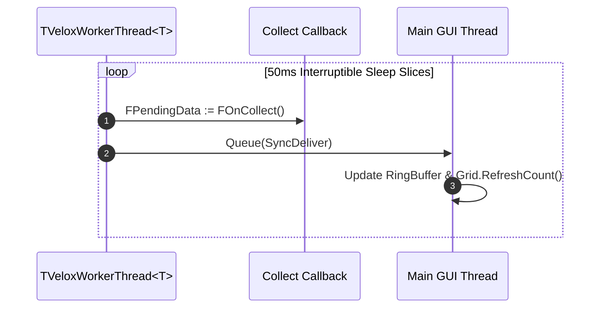

<p align="center">
  
</p>

<p align="center">
  <a href="#-7-core-framework-modules"></a>
  <a href="#-getting-started--installation"></a>
  <a href="#-before-vs-after-85-less-boilerplate"></a>
  <a href="#-automated-verification-suite-5959-passing"></a>
  <a href="#-12-hard-won-win32--vcl--lcl-gotchas-solved"></a>
  <a href="LICENSE"></a>
</p>

<p align="center">
  
</p>

<p align="center">
  <strong>VeloxUI</strong> is a high-velocity, zero-dependency <strong>Object Pascal (Delphi VCL &amp; Lazarus / Free Pascal LCL)</strong> desktop UI and MVVM micro-framework. It distills every hard-won Win32, Windows 11 DWM (Mica/Acrylic/Dark Titlebar), undocumented <code>uxtheme.dll</code> dark scrollbar, High-DPI control alignment, hardware-accelerated <code>GDI+</code> vector rendering, flicker-free virtual <code>TListView</code>, and NT Kernel pattern into <strong>7 drop-in units</strong>.
</p>

---

## 🎯 Why VeloxUI Exists

Native Object Pascal (`Delphi` and `Free Pascal / Lazarus`) is one of the most productive secrets in systems software: it compiles in **~2 seconds** into a **~1.8 MB standalone native executable** that starts in **45 ms**, uses **~11 MB of RAM**, and requires **zero external runtime DLLs** (compared to 180+ MB and 300+ MB RAM for Electron/WebView2).

However, building a **modern Windows 11 Fluent Dark Mode** application in raw VCL/LCL traditionally forces developers to fight dozens of undocumented Win32 quirks:
- Native `TComboBox` controls ignore `.Height` and render taller than adjacent buttons at High-DPI.
- Standard bordered `TEdit` controls clip placeholder text against the top-left border with no vertical centering.
- Native `TCheckBox` controls draw black-on-dark unreadable captions when placed on dark panels due to Win32 `UXTheme` overrides.
- Standard `TListView` tables flash white on background erase, lose row selection on refresh, and show blinding white scrollbars in dark mode.
- Standard GDI `Canvas.RoundRect` and `Canvas.Polyline` look jagged and aliased on modern High-DPI displays.

**VeloxUI solves all of these permanently.** Drop the `src/` folder into any Delphi or Lazarus project and build production-grade, flicker-free Windows 11 telemetry dashboards and desktop tools with **85% less code**.

---

## ⚡ Before vs. After: 85% Less Boilerplate

| Task | Raw Win32 / VCL / LCL Boilerplate | With **VeloxUI** |
| :--- | :---: | :---: |
| **Vertically Centered Search Box with Focus Ring & `Esc` Clear** | ~65 lines (`TPanel` + `bsNone` `TEdit` + 4 event handlers) | **1 line** (`TVeloxSearchBox.CreateBox(...)`) |
| **High-DPI `TComboBox` Pixel-Matched to `TButton` Height** | ~45 lines (`CB_SETITEMHEIGHT` + `GetWindowRect` loop + `OnDrawItem`) | **1 line** (`TVeloxControls.SyncComboBoxHeight(...)`) |
| **Dark-Panel CheckBox (Bypassing Win32 UXTheme Black Text Bug)** | ~30 lines (Captionless `TCheckBox` + synced `crHandPoint` `TLabel`) | **1 line** (`TVeloxDarkCheckBox.CreateCheck(...)`) |
| **Win11 Dark Title Bar + Mica Backdrop + Dark Scrollbars + Recursive Theme** | ~120 lines (`dwmapi.dll` + `uxtheme.dll` ordinals `133`/`135` + tree walk) | **2 lines** (`ApplyFormTheme` + `ApplySystemBackdrop`) |
| **GDI+ Anti-Aliased KPI Card with Sparkline & Auto-Fit Typography** | ~140 lines (GDI+ Flat API loader + polygon fill + font collision loop) | **1 line** (`TVeloxGdiPlus.DrawMetricCard(...)`) |
| **Flicker-Free Virtual `TListView` (`OwnerData` + QuickSort + `▲`/`▼` Arrows)** | ~160 lines (`LVS_EX_DOUBLEBUFFER` + QuickSort + UTF-8/UTF-16 arrows) | **4 lines** (`TVeloxVirtualGrid<T>.Create(...)`) |
| **Themed Inspector Modal Dialog (Header, Subtitle, Consolas Memo, Footer)** | ~95 lines (`TForm.CreateNew` + 6 child controls + anchors) | **1 line** (`TVeloxControls.CreateModalDialog(...)`) |

### Side-by-Side Code Comparison

```pascal
// ❌ WITHOUT VELOXUI (~420 lines of manual Win32 / DWM / GDI+ / ListView plumbing)
// Requires manual LoadLibrary('dwmapi.dll'), MAKEINTRESOURCEA(135) uxtheme ordinals,
// manual GDI+ startup token & path arcs, manual pnlSearchBox wrapper events,
// manual CB_SETITEMHEIGHT ($0151) feedback loop, and manual QuickSort.

// ✅ WITH VELOXUI (~20 lines for an entire Fluent Dark Dashboard)
procedure TDashboardForm.FormCreate(Sender: TObject);
begin
  FColors := TVeloxUtils.GetThemeColors(vtDark);

  // 1. Vertically centered search box with focus accent border & Esc-to-clear
  FSearch := TVeloxSearchBox.CreateBox(Self, pnlHeader, 16, 18, 190, 28, 'Search processes...', FColors, OnSearchChange);

  // 2. High-DPI ComboBox synced to exact pixel height of adjacent button
  TVeloxControls.SyncComboBoxHeight(cmbInterval, btnPin, 28);

  // 3. Dark-panel safe CheckBox (never renders black text on dark backgrounds)
  FTrayChk := TVeloxDarkCheckBox.CreateCheck(Self, pnlSidebar, 20, 8, 160, 'Minimize to tray', FColors, True);

  // 4. Flicker-free OwnerData Virtual Grid with LVS_EX_DOUBLEBUFFER & natural sorting
  FGrid := TVeloxVirtualGrid<TProcessRow>.Create(lvProcesses);
  FGrid.AddColumn('PID', 70, taLeftJustify, False);               // Text/ID: Ascending first
  FGrid.AddColumn('Process Name', 200, taLeftJustify, False);     // Text: Ascending first
  FGrid.AddColumn('Working Set (RAM)', 130, taRightJustify, True); // Numeric: Descending first!

  // 5. Apply Win11 Dark Titlebar, Mica Backdrop, Dark Scrollbars & Recursive Theme
  TVeloxThemeEngine.ApplyFormTheme(Self, vtDark);
  TVeloxThemeEngine.ApplySystemBackdrop(Handle, vbtMica);
end;
```

---

## 📦 7 Core Framework Modules

### 1. [`src/Velox.Types.pas`](src/Velox.Types.pas) — Tokens, Ring Buffers & Cross-Compiler Glyphs
| Component | Purpose |
| :--- | :--- |
| **`TVeloxThemeColors`** | Semantic Fluent Dark (`vtDark`) and Daylight (`vtLight`) palettes (`Background`, `Surface`, `SurfaceCard`, `Accent`, `Success`, `Warning`, `Danger`, `Border`) |
| **`TVeloxRingBuffer`** | Fixed-capacity `O(1)` zero-allocation circular buffer for rolling sparkline histories with `.Latest`, `.Average`, `.Peak`, and `.ToArray` |
| **Cross-Compiler Unicode Constants** | `VELOX_ARROW_ASC` (`▲`), `VELOX_ARROW_DESC` (`▼`), `VELOX_TREE_BRANCH` (`└─`), and `VELOX_MIDDOT` (`·`) encoded automatically as UTF-8 for FPC/LCL and UTF-16 for Delphi VCL |
| **`TVeloxUtils`** | `BlendColor`, `FormatBytes`, `FormatMegabytes` (auto-scales to `GB`), `FormatRateKBps` (auto-scales to `MB/s`), `FormatPercent`, and `FormatDuration` |

### 2. [`src/Velox.Theme.pas`](src/Velox.Theme.pas) — Win11 DWM Mica, Dark Titlebars & Undocumented `uxtheme.dll`
| Component | Purpose |
| :--- | :--- |
| **`TVeloxThemeEngine.ApplyFormTheme`** | Recursively styles any `TForm` and all nested controls (`TPanel`, `TLabel`, `TEdit`, `TMemo`, `TListView`, `TComboBox`) in one call |
| **`TVeloxThemeEngine.ApplyDarkTitleBar`** | Enables Windows 10/11 Immersive Dark Title Bar via `DwmSetWindowAttribute` (`Attr 20` with automatic fallback to `Attr 19`) |
| **`TVeloxThemeEngine.ApplySystemBackdrop`** | Enables Windows 11 22H2+ **Mica** (`vbtMica`), **Acrylic** (`vbtAcrylic`), or **Mica Alt** (`vbtTabbed`) via `DWMWA_SYSTEMBACKDROP_TYPE` (`Attr 38`) |
| **`TVeloxThemeEngine.ApplyDarkScrollbars`** | Resolves undocumented `uxtheme.dll` ordinals `135` (`SetPreferredAppMode`), `133` (`AllowDarkModeForWindow`), and `SetWindowTheme('DarkMode_Explorer', nil)` for native dark scrollbars on `TListView` and `TMemo` |
| **`TVeloxThemeEngine.DetectSystemTheme`** | Reads `HKCU\...\Personalize\AppsUseLightTheme` to match the user's Windows OS theme automatically |

### 3. [`src/Velox.GdiPlus.pas`](src/Velox.GdiPlus.pas) — Hardware-Accelerated `GDI+` Vector & Telemetry Engine
| Component | Purpose |
| :--- | :--- |
| **`TVeloxGdiPlus.DrawMetricCard`** | Complete 1-call KPI Card renderer with title, auto-fitting primary metric value (shrinks font size if needed so it never collides with the upper-right sparkline), subtitle, rolling sparkline, and bottom progress bar |
| **`TVeloxGdiPlus.DrawSparkline`** | Sub-pixel anti-aliased (`SmoothingModeAntiAlias`) time-series polyline with translucent vertical polygon area fill |
| **`TVeloxGdiPlus.DrawCard`** | Crisp rounded rectangle container with `1px` border and automatic GDI fallback |
| **`TVeloxGdiPlus.DrawProgressBar` / `DrawBadge`** | Smooth pill-shaped progress bars and centered bold status badges |

### 4. [`src/Velox.Controls.pas`](src/Velox.Controls.pas) — Fluent Control Factories & High-DPI Fixers
| Component | Purpose |
| :--- | :--- |
| **`TVeloxSearchBox`** | Wraps a borderless `bsNone` `TEdit` inside a custom-bordered `TPanel` with exact vertical centering (`Top = (Height - 16) div 2`), `10px` left margin, focus ring highlight, and `Esc`-to-clear |
| **`TVeloxControls.SyncComboBoxHeight`** | Uses `CB_SETITEMHEIGHT` (`$0151`) + `GetWindowRect` feedback loop + `SetWindowPos` so `csOwnerDrawFixed` `TComboBox` controls match adjacent `TButton` heights to the exact pixel at any DPI |
| **`TVeloxDarkCheckBox`** | Pairs a captionless `TCheckBox` with a synchronized `crHandPoint` `TLabel` so dark-mode checkboxes never suffer from the Win32 `UXTheme` black-text bug |
| **`TVeloxControls.CreateModalDialog`** | Scaffolds a themed modal dialog (`HeaderPanel`, `TitleLabel`, `SubtitleLabel`, `BodyPanel` or `Consolas` `TMemo`, `FooterPanel`, `PrimaryButton`, `CancelButton`) in 1 call |

### 5. [`src/Velox.VirtualGrid.pas`](src/Velox.VirtualGrid.pas) — Generic Zero-Flicker Virtual Table (`TVeloxVirtualGrid<T>`)
| Component | Purpose |
| :--- | :--- |
| **`AttachListView` & `EnableNativeDoubleBuffer`** | Configures `OwnerData := True`, `RowSelect := True`, `ColumnClick := True`, and sends `LVM_SETEXTENDEDLISTVIEWSTYLE` (`$1036`) with `LVS_EX_DOUBLEBUFFER` (`$00010000`) |
| **`AddColumn` & `ClickColumn`** | Registers columns with `DefaultDescending` metadata: clicking a numeric/metric column sorts **descending first** (largest consumers on top); clicking a text/ID column sorts **ascending first** |
| **`SortList`** | Generic in-place `QuickSort` over `TList<T>` using a clean `TVeloxCompareFunc<T>` callback |
| **`RefreshCount` & `StretchLastColumn`** | Updates virtual row count without resetting selection/scroll position when row count is unchanged, and stretches the final column to `ClientWidth` |

### 6. [`src/Velox.Async.pas`](src/Velox.Async.pas) — Interruptible Background Poller & Alert State Machine
| Component | Purpose |
| :--- | :--- |
| **`TVeloxPoller<T>`** | Generic background worker thread that runs collection callbacks off-thread, marshals results via `TThread.Queue`, supports live `SetInterval(Ms)`, and sleeps in `50ms` slices for `<50ms` instant shutdown |
| **`TVeloxThresholdAlert`** | Hysteresis + sustained streak + cooldown state machine for CPU/RAM/latency alerting without notification flapping |

### 7. [`src/Velox.System.pas`](src/Velox.System.pas) — Win32 & NT Kernel Helpers (`TVeloxSystem`)
| Component | Purpose |
| :--- | :--- |
| **`GetProcessCommandLine(PID)`** | Queries `NtQueryInformationProcess` (`ProcessCommandLineInformation = 60` in `ntdll.dll`) using only `PROCESS_QUERY_LIMITED_INFORMATION` (`$1000`)—no `PROCESS_VM_READ` or Admin required for same-user processes |
| **`GetFileVersionMetadata(Path)`** | Extracts `FileDescription`, `CompanyName` (Digital Publisher), and `FileVersion` via `version.dll` |
| **`GetProcessGuiResources(PID)`** | Reads per-process `GDI` and `USER` object counts via `GetGuiResources` (`user32.dll`) for handle leak detection |
| **`GetProcessAffinity` / `SetProcessAffinity`** | Reads and updates logical CPU core affinity masks (`GetProcessAffinityMask` / `SetProcessAffinityMask`) with `PID 0`/`4` guards |
| **`TrimProcessWorkingSet(PID)`** | Reclaims unused physical RAM pages from a process via `EmptyWorkingSet` (`psapi.dll`) |
| **`RunTask(Cmd, RunAsAdmin)`** | Launches executables or commands with optional `'runas'` UAC Administrator elevation (`ShellExecuteExW`) |

---

## 🏗 Compact Architecture Diagrams

### 1. High-Level Layer Flow



### 2. Win11 Dark Mode & GDI+ Rendering Pipeline



### 3. Interruptible Async Polling Lifecycle



---

## 🧠 12 Hard-Won Win32 / VCL / LCL Gotchas Solved

We built **VeloxUI** so you never have to waste hours debugging these 12 obscure Delphi, Lazarus/FPC, and Win32 desktop traps again:

| # | The Win32 / Delphi / Lazarus Trap | Root Cause | How **VeloxUI** Solves It Automatically |
| :---: | :--- | :--- | :--- |
| **1** | **`TComboBox` ignores `.Height`** and renders too tall or too short next to `TButton` at High-DPI | Win32 `ComboBox` computes its outer height from `CB_SETITEMHEIGHT ($0151) + 2*SM_CYEDGE` instead of `WM_SIZE` | [`TVeloxControls.SyncComboBoxHeight`](src/Velox.Controls.pas) measures the reference button via `GetWindowRect` and runs a 2-pass `CB_SETITEMHEIGHT` feedback loop |
| **2** | **`TEdit` placeholder & text are pinned to the top-left border** with no vertical centering | Standard Win32 single-line edit controls do not support vertical internal padding | [`TVeloxSearchBox`](src/Velox.Controls.pas) wraps a borderless `bsNone` `TEdit` at `Top = (Height - 16) div 2` inside a custom-painted `TPanel` with `10px` left margin |
| **3** | **`TCheckBox` caption renders black-on-dark** and is invisible on dark panels | Windows `UXTheme` overrides `TCheckBox` text color when themes are enabled | [`TVeloxDarkCheckBox`](src/Velox.Controls.pas) sets `CheckBox.Caption := ''` and pairs a synchronized `crHandPoint` `TLabel` |
| **4** | **`TListView` flashes white on update** and loses selected row / scroll position | Assigning `Items.Count` unconditionally triggers `WM_ERASEBKGND` and resets viewport state | [`TVeloxVirtualGrid<T>`](src/Velox.VirtualGrid.pas) enables `LVS_EX_DOUBLEBUFFER ($10000)` and only updates `Items.Count` when the count changes, calling `Invalidate` otherwise |
| **5** | **`TListView` and `TMemo` show bright white scrollbars** in dark mode | Win32 common controls default to the light `"Explorer"` theme unless opted in via undocumented `uxtheme.dll` ordinals | [`TVeloxThemeEngine`](src/Velox.Theme.pas) invokes `uxtheme.dll` Ordinal `135` (`SetPreferredAppMode`), Ordinal `133` (`AllowDarkModeForWindow`), and `SetWindowTheme('DarkMode_Explorer', nil)` |
| **6** | **Compile Error on `Rect(0, 0, W, H)`** (`Incompatible types: got "RECT" expected "TRect"`) | Putting `Windows` after `Types` in `uses` causes the `Windows.RECT` struct to shadow `Types.Rect()` function | All VeloxUI units enforce `Windows` **before** `Types` in `uses` |
| **7** | **Compile Error on `GetEnvironmentVariable('PATH')`** (`Wrong number of parameters`) | `Windows.GetEnvironmentVariable(PChar, PChar, DWORD)` shadows `SysUtils.GetEnvironmentVariable(string)` | Always qualify `SysUtils.GetEnvironmentVariable` when `Windows` is in `uses` |
| **8** | **Compile Error on `odSelected in State`** in `OnDrawItem` under Lazarus/FPC | `Types` defines a conflicting `TOwnerDrawState`; LCL requires `LCLType` after `Types` | [`Velox.Controls.pas`](src/Velox.Controls.pas) includes `{$IFDEF FPC} LCLType, {$ENDIF}` immediately after `Types` |
| **9** | **FPC 3.2.2 Error `(3339)`**: `Global Generic template references static symtable` | Free Pascal generic classes cannot reference constants declared in the `implementation` global scope | [`Velox.VirtualGrid.pas`](src/Velox.VirtualGrid.pas) scopes Win32 constants locally inside generic methods or in `interface` |
| **10** | **FPC 3.2.2 `TThread.Queue` incompatibility** with anonymous closures | FPC 3.2.2 `TThread.Queue` expects a `TThreadMethod` (`procedure of object`) | [`TVeloxWorkerThread<T>`](src/Velox.Async.pas) uses a typed `FPendingData: T` field and `Queue(SyncDeliver)` method |
| **11** | **Corrupted `▲`/`▼` sort arrows (Mojibake)** between Delphi and Lazarus | Lazarus LCL strings are UTF-8 while Delphi VCL strings are UTF-16 | [`Velox.Types.pas`](src/Velox.Types.pas) defines `VELOX_ARROW_ASC` / `VELOX_ARROW_DESC` using `#$E2#$96#$B2` on FPC and `#$25B2` on Delphi |
| **12** | **`OpenProcess(PROCESS_VM_READ)` fails with Access Denied** when reading process command lines | Reading another process's PEB directly requires `PROCESS_VM_READ` | [`TVeloxSystem.GetProcessCommandLine`](src/Velox.System.pas) queries `NtQueryInformationProcess` Class `60` (`ProcessCommandLineInformation`), which only requires `PROCESS_QUERY_LIMITED_INFORMATION ($1000)` |

---

## 🧪 Automated Verification Suite (`59/59 Passing`)

VeloxUI includes a self-contained console verification suite ([`tests/veloxtest.lpr`](tests/veloxtest.lpr)) that tests every module headlessly in ~2.4 seconds:

```powershell
# Compile and run the 59-assertion verification suite with Lazarus / Free Pascal
lazbuild -B tests\veloxtest.lpi
.\tests\lib\veloxtest.exe
```

| Test Suite Section | Assertions | What Is Verified |
| :--- | :---: | :--- |
| **`[1/7]` RingBuffer & Utils** | `15` | Circular capacity cap, oldest eviction, `.Latest`/`.Peak`/`.Average`, Dark/Light token palettes, `BlendColor`, `FormatBytes`/`MB`/`KBps`/`Percent`/`Duration`, UTF-8/UTF-16 arrows |
| **`[2/7]` GDI+ Vector Engine** | `4` | Hardware-accelerated `DrawCard`, `DrawProgressBar`, `DrawBadge`, and `DrawSparkline` on offscreen bitmaps |
| **`[3/7]` DWM & UXTheme Engine** | `2` | Process-wide `InitializeProcessDarkMode` (Ordinal 135) and OS registry `DetectSystemTheme` |
| **`[4/7]` Fluent Controls & Modals** | `12` | `TVeloxSearchBox` 28px wrapper, `bsNone`, `Top=6` vertical centering, `Left=10` margin; `TVeloxDarkCheckBox` caption decoupling; `SyncComboBoxHeight`; `ApplyFormTheme`; `CreateModalDialog` |
| **`[5/7]` Generic VirtualGrid** | `9` | Automatic `OwnerData`, column registration, numeric column defaulting to **descending** on first click, text column defaulting to **ascending** on first click, QuickSort ordering, header arrows, `RefreshCount` |
| **`[6/7]` Async Poller & Alerts** | `9` | Sustained streak gating (`2/2`), immediate escalation to `vsCritical`, hysteresis recovery margin, live `SetInterval`, and `<50ms` interruptible thread shutdown |
| **`[7/7]` Win32 & NT System** | `8` | `NtQueryInformationProcess(60)` command-line extraction, `PID 0` guard, `version.dll` Microsoft publisher metadata on `kernel32.dll`, `GetGuiResources`, CPU affinity masks, `EmptyWorkingSet`, and `RunTask` guards |

---

## 🚀 Getting Started & Installation

### 1. Clone the Repository
```powershell
git clone https://github.com/amafjarkasi/velox-ui.git
```

### 2. Add to Lazarus (`LCL`) or Delphi (`VCL`)
- **Lazarus**: In **Project → Project Options → Compiler Options → Paths**, add `..\velox-ui\src` to **Other unit files (`-Fu`)**.
- **Delphi**: In **Project → Options → Delphi Compiler → Search path**, add `..\velox-ui\src`.

### 3. Check Out the Complete Quick-Start Example
See [`examples/QuickStartDashboard.pas`](examples/QuickStartDashboard.pas) for a complete, ready-to-run Windows 11 Dark Mode telemetry dashboard built in ~90 lines of code.

---

## 📄 License

Released under the [MIT License](LICENSE).
