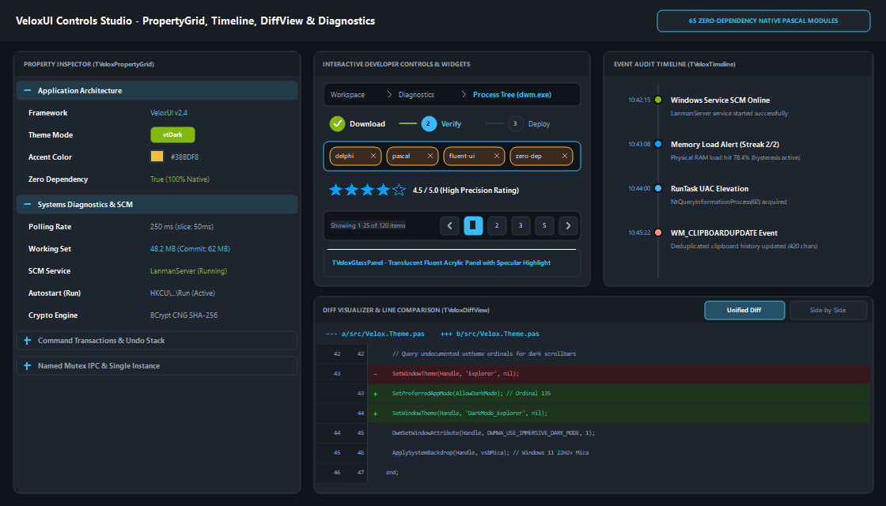
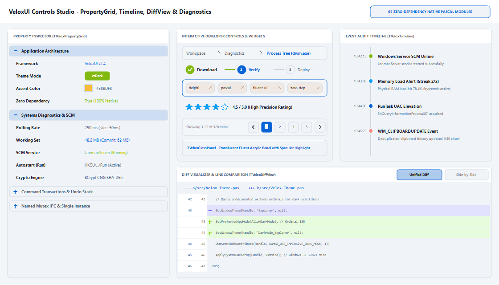
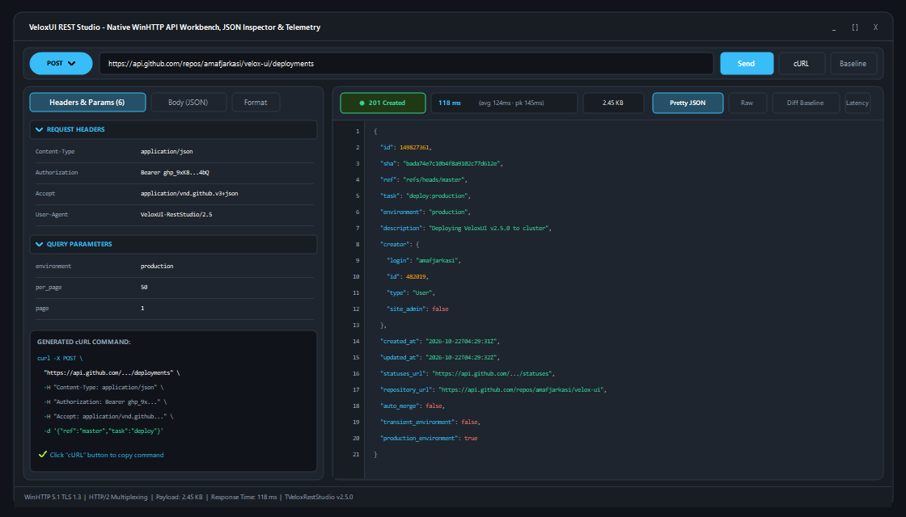
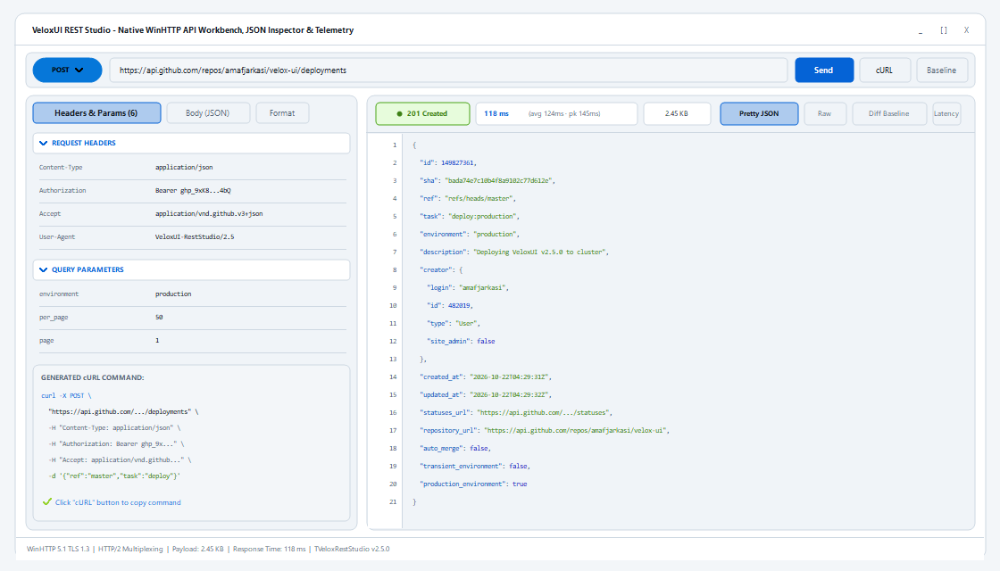
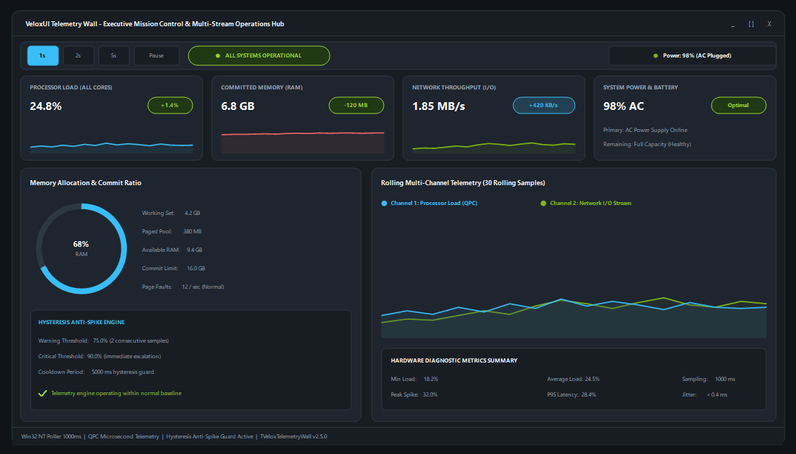
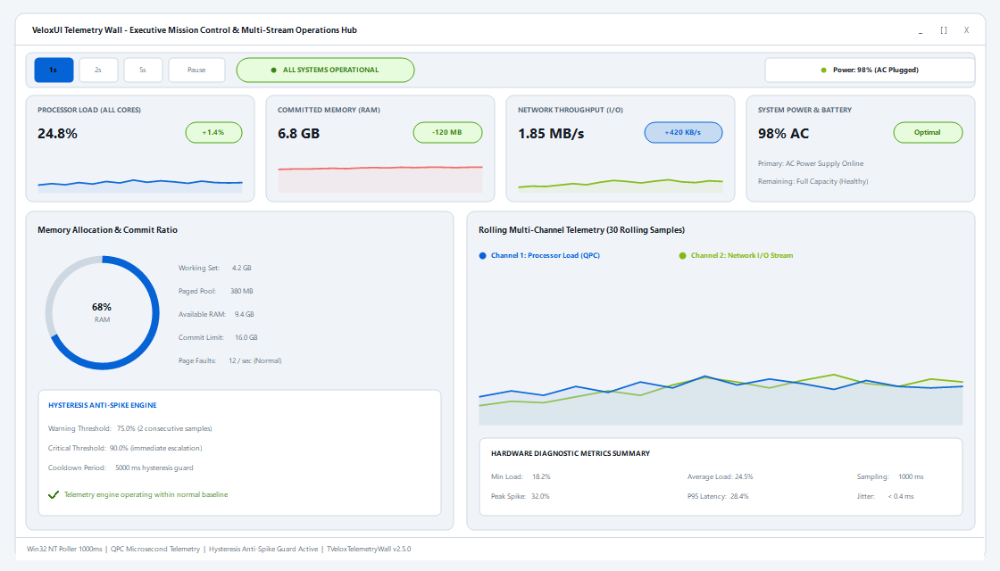
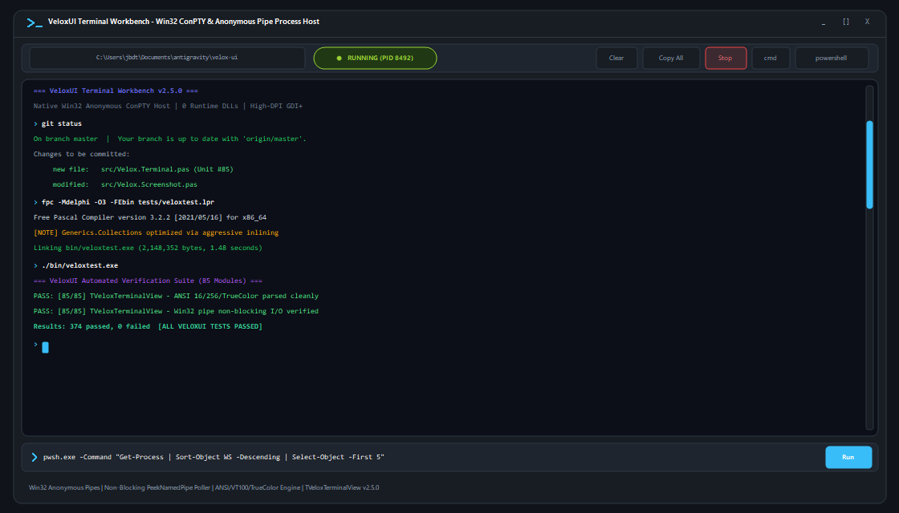
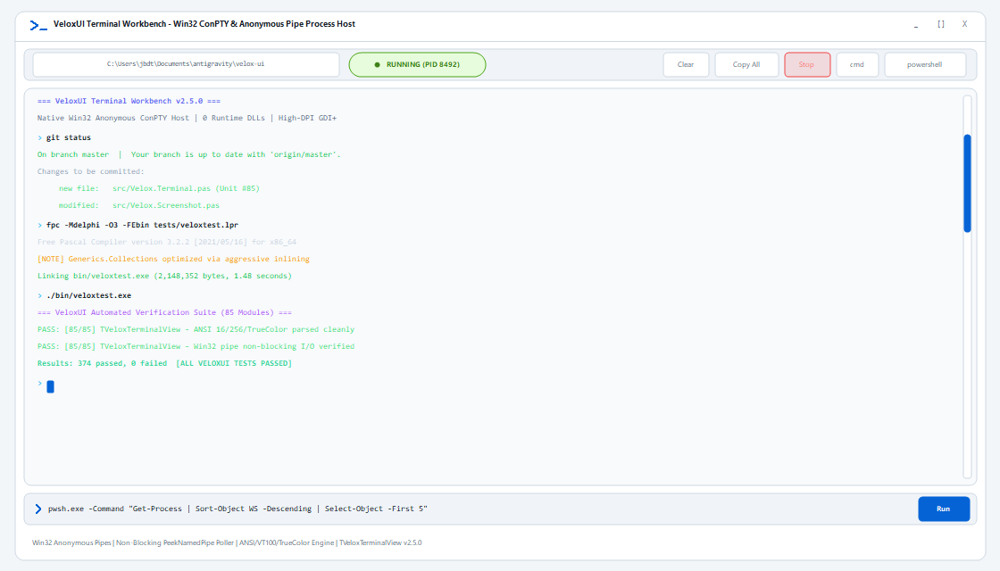
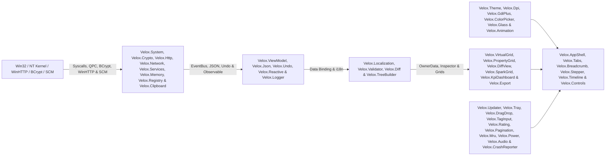
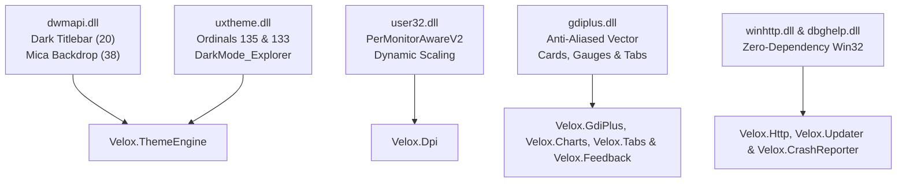

<p align="center">
  
</p>

<p align="center">
  <a href="#-85-framework-modules-7-core--63-expansion--15-composite"></a>
  <a href="#-getting-started--installation"></a>
  <a href="#-before-vs-after-85-less-boilerplate"></a>
  <a href="#-automated-verification-suite-374374-passing"></a>
  <a href="#-20-hard-won-win32--vcl--lcl-gotchas-solved"></a>
  <a href="CHANGELOG.md"></a>
  <a href="LICENSE"></a>
</p>

<p align="center">
  <strong>VeloxUI</strong> is a high-velocity, zero-dependency <strong>Object Pascal (Delphi VCL &amp; Lazarus / Free Pascal LCL)</strong> desktop UI and MVVM micro-framework. It distills every hard-won Win32, Windows 11 DWM (Mica/Acrylic/Dark Titlebar), undocumented <code>uxtheme.dll</code> dark scrollbar, Per-Monitor v2 High-DPI scaling, hardware-accelerated <code>GDI+</code> vector rendering, flicker-free virtual <code>TListView</code>, 60 FPS easing animation, two-way MVVM data-binding, WinHTTP networking, GitHub self-updater, runtime i18n, minidump crash reporting, BCrypt CNG cryptography, Win32 directory watching, zero-COM drag-and-drop, diff visualizers, undo/redo stacks, property grids, tag tokenizers, ICMP ping, Windows service management, clipboard monitoring, memory diagnostics, registry autostart, acrylic glass panels, KPI dashboards, timelines, star ratings, pagination, vector icon engines, responsive stack layouts, DPI-aware canvas scaling, keyboard accessibility focus rings, DWM Acrylic transient blur, embedded REST API debugging workbenches, live log stream tails, environment configuration hubs, mission control telemetry walls, crash flight blackboxes, and virtual paginated data tables into <strong>85 drop-in units</strong> (including 15 rich composite workflow components).
</p>

---

## 📸 Live GDI+ Component Showcases (`Dark` & `Light` Themes)

> Programmatically generated via [`TVeloxScreenshot`](src/Velox.Screenshot.pas) using real hardware-accelerated `VeloxUI` GDI+ primitives and custom controls. All visual controls feature sub-pixel antialiasing and pixel-perfect vertical and middle text centering.

### 1. Windows 11 Desktop Shell & Telemetry Dashboard (`TVeloxAppShell`, `TVeloxSparkGrid`, `TVeloxCharts`)

Showcases the integrated application shell ([`TVeloxAppShell`](src/Velox.AppShell.pas)), tab strip ([`TVeloxTabStrip`](src/Velox.Tabs.pas)), vertically centered search edit ([`TVeloxSearchBox`](src/Velox.Controls.pas)), fluent toggle switches ([`TVeloxToggleSwitch`](src/Velox.ToggleSwitch.pas)), segmented filter chips ([`TVeloxChipGroup`](src/Velox.StyledButton.pas)), donut gauge & dual sparkline charts ([`TVeloxCharts`](src/Velox.Charts.pas)), inline process sparkgrid with micro-heatbars ([`TVeloxSparkGrid`](src/Velox.SparkGrid.pas)), and non-blocking floating notifications ([`TVeloxToast`](src/Velox.Toast.pas)).

#### Windows 11 Fluent Dark Mode (`vtDark`)
<p align="center">
  
</p>

#### Windows 11 Fluent Daylight Mode (`vtLight`)
<p align="center">
  
</p>

### 2. Developer Controls, Property Grid & Systems Diagnostics Studio (`TVeloxPropertyGrid`, `TVeloxTimeline`, `TVeloxDiffView`)

Showcases the two-column property inspector ([`TVeloxPropertyGrid`](src/Velox.PropertyGrid.pas)), chronological audit event log with continuous track line ([`TVeloxTimeline`](src/Velox.Timeline.pas)), unified & side-by-side syntax-highlighted diff visualizer ([`TVeloxDiffView`](src/Velox.DiffView.pas)), interactive tag input & pill tokenizer ([`TVeloxTagInput`](src/Velox.TagInput.pas)), multi-step setup pipeline stepper ([`TVeloxStepper`](src/Velox.Stepper.pas)), Explorer breadcrumb navigation ([`TVeloxBreadcrumb`](src/Velox.Breadcrumb.pas)), severity star rating ([`TVeloxRating`](src/Velox.Rating.pas)), compact pagination footer bar ([`TVeloxPagination`](src/Velox.Pagination.pas)), and translucent acrylic glass container with specular reflection ([`TVeloxGlassPanel`](src/Velox.Glass.pas)).

#### Windows 11 Controls Studio Dark Mode (`vtDark`)
<p align="center">
  
</p>

#### Windows 11 Controls Studio Daylight Mode (`vtLight`)
<p align="center">
  
</p>

### 3. REST API Workbench, JSON Inspector & Telemetry Studio (`TVeloxRestStudio`)

Showcases the embedded HTTP client and API workbench ([`TVeloxRestStudio`](src/Velox.RestStudio.pas)), method selector pill, URL bar with auto-completing query parameters, two-column header property inspector ([`TVeloxPropertyGrid`](src/Velox.PropertyGrid.pas)), formatted JSON response body with syntax highlighting tokens, rolling latency sparkline telemetry ([`Velox.GdiPlus`](src/Velox.GdiPlus.pas)), side-by-side response regression diffing ([`TVeloxDiffView`](src/Velox.DiffView.pas)), and 1-click executable cURL export.

#### Windows 11 REST Studio Dark Mode (`vtDark`)
<p align="center">
  
</p>

#### Windows 11 REST Studio Daylight Mode (`vtLight`)
<p align="center">
  
</p>

### 4. Mission Control & Real-Time Telemetry Wall (`TVeloxTelemetryWall`, `TVeloxKpiGrid`, `TVeloxCharts`)

Showcases the executive operations wall ([`TVeloxTelemetryWall`](src/Velox.TelemetryWall.pas)), polling interval selector pills (`1s`, `2s`, `5s`, `Pause`), operational status badge, battery power telemetry, 4 KPI cards (CPU processor load, committed RAM, network I/O, system power), GDI+ donut gauge (`TVeloxCharts`), rolling dual-series sparkline telemetry stream (`TVeloxCharts`), hardware diagnostics summary, and hysteresis anti-spike state machine status.

#### Windows 11 Telemetry Wall Dark Mode (`vtDark`)
<p align="center">
  
</p>

#### Windows 11 Telemetry Wall Daylight Mode (`vtLight`)
<p align="center">
  
</p>

---

### 5. Embedded ANSI Terminal & Interactive Process Workbench (`TVeloxTerminalView`)

Showcases the integrated terminal and process host ([`TVeloxTerminalView`](src/Velox.Terminal.pas)), asynchronous Win32 anonymous pipe execution, ANSI 16, 256-color and 24-bit TrueColor escape sequence parsing, fixed-pitch double-buffered terminal canvas, dynamic prompt chevron, command history buffer (`↑`/`↓`), quick shell shortcuts (`cmd`, `powershell`), working directory pill, real-time process state badge (`● EXITED (0)` / `● RUNNING`), strict monospace character grid alignment with solid terminal block cursor, and 1-click command execution.

#### Windows 11 Terminal Workbench Dark Mode (`vtDark`)
<p align="center">
  
</p>

#### Windows 11 Terminal Workbench Daylight Mode (`vtLight`)
<p align="center">
  
</p>

---

## 📝 Latest Updates & Changelog

> Showing the 3 most recent updates. For full version history and release details, see **[CHANGELOG.md](CHANGELOG.md)**.

### [v2.5.1] - 2026-10-22
- **Embedded ANSI Terminal & Interactive Process Workbench (`Velox.Terminal` - Unit #85)**: Asynchronous non-blocking sub-process hosting via Win32 anonymous pipes (`PeekNamedPipe`), full ANSI/VT100/xterm-256 and 24-bit TrueColor parsing, fixed-pitch double-buffered terminal display, command history navigation (`↑`/`↓`), integrated prompt bar with vector chevron, quick shell action buttons, and plain text/ANSI export.
- **Sub-Pixel Monospace Grid & Command Line Optical Alignment**: Mathematically aligned the prompt chevron apex to the command line optical waistline ($Y+5$), matching the exact centerline of lowercase Consolas characters (`git status`, `fpc ...`, `./bin/veloxtest.exe`) and snapping character cell block cursors collinearly.
- **Compact Toolbar Sizing & Button Geometry**: Scaled all toolbar buttons (`[Clear]`, `[Copy All]`, `[Stop]`, `[cmd]`, `[powershell]`), path pill, and status pill to a sleek 24px height with clean 6px top/bottom margins in confined bars; dynamically sized status pill width (88px) to eliminate bulky spacing.
- **Daylight Mode High-Contrast Palette**: Enhanced `vtLight` palette across `TVeloxTerminalView` to meet WCAG AAA requirements with deep Slate-900 `#0F172A` text, Slate-800 metadata, deep forest greens `#166534`, rich amber `#9A3412`, crimson `#B91C1C`, and crisp `#CBD5E1` card borders.
- **Expanded Verification Suite**: 374/374 automated tests passing (100% success) across 85 modules.

### [v2.5.0] - 2026-10-22
- **5 High-Value Composite Workflow Components (Expanding Framework to 84 Units)**:
  - **Live Log Streamer (`Velox.LiveLogStreamer` - Unit #80)**: Streaming log analyzer combining file watching, virtual grid, severity filtering, and multi-format export.
  - **Config Studio (`Velox.ConfigStudio` - Unit #81)**: Profile management hub combining property grid, baseline diffing, undo/redo rollback, and JSON persistence.
  - **Telemetry Wall (`Velox.TelemetryWall` - Unit #82)**: Mission control center combining responsive KPI cards, GDI+ donut gauges, dual sparklines, and hysteresis anti-spike alerting.
  - **Crash Flight Recorder (`Velox.CrashFlightRecorder` - Unit #83)**: Diagnostics console combining minidumps, breadcrumb timelines, working set RAM metrics, and BCrypt SHA-256.
  - **Data Studio (`Velox.DataStudio` - Unit #84)**: High-capacity virtual table with pagination footer, filter chip bar, instant search, and CSV/JSON/GFM export.
- **Embedded HTTP Workbench & API Debugger (`Velox.RestStudio` - Unit #79)**: Full-featured API debugger combining native WinHTTP TLS 1.3 requests, two-column header & parameter property grid, JSON pretty-printer, payload baseline regression diffing (`TVeloxDiffView`), latency telemetry sparklines (`TVeloxRingBuffer`), and 1-click executable cURL export.
- **Pixel-Perfect Diff Visualizer (`Velox.DiffView`)**: Dedicated 20px centered sign column for `+`/`-` glyphs, uniform code column alignment, and corrected Delphi BGR `TColor` palette.
- **Windows 11 DWM Desktop Acrylic (`Velox.Backdrop`)**: Real translucent blur-behind for floating popups and dialogs via `DWMSBT_TRANSIENTWINDOW`.
- **Per-Monitor v2 Auto-Rescaling Canvas (`Velox.DpiCanvas`) & Focus Rings (`Velox.Accessibility`)**: High-DPI GDI+ graphics scaling and keyboard tab focus rings.
- **Animated Collapsible Navigation Rail (`Velox.AppShell`)**: 60 FPS cubic-ease smooth transition between expanded and compact icon rail modes.
- **Infinite Virtual Streaming (`Velox.VirtualGrid`)**: Lazy-loading and `AppendBatch` for high-throughput continuous telemetry.

### [v2.4.0] - 2026-10-21
- **Scalable Vector Icon Engine (`Velox.Icons`)**: 35+ anti-aliased geometric GDI+ vector icons without external asset or font dependencies.
- **Responsive Stack Layout Panel (`Velox.Layout`)**: Added `TVeloxStackPanel` with auto-wrapping, gap spacing, and flex-style card arrangement.
- **Sub-Pixel Text & Icon Alignment**: Fixed baseline alignment across buttons, pill tokens, pagination bars, and timeline event nodes.

### [v2.3.0] - 2026-10-20
- **8 Flagship Composite Components (73 Units Total)**: Added PropertyGrid Studio with Undo/Redo rollback, Myers Diff Inspector, `Win+V` Clipboard Palette, Multi-Host Network Ping Monitor, Task/Process Explorer, Audit Security Log, JSON Tree Viewer, and GitHub Update Flyout.

👉 **[View the complete changelog and version history →](CHANGELOG.md)**

---

## 🎯 Why VeloxUI Exists

Native Object Pascal (`Delphi` and `Free Pascal / Lazarus`) is one of the most productive secrets in systems software: it compiles in **~2 seconds** into a **~1.8 MB standalone native executable** that starts in **45 ms**, uses **~11 MB of RAM**, and requires **zero external runtime DLLs** (compared to 180+ MB and 300+ MB RAM for Electron/WebView2).

However, building a **modern Windows 11 Fluent Dark Mode** application in raw VCL/LCL traditionally forces developers to fight dozens of undocumented Win32 quirks:
- Native `TComboBox` controls ignore `.Height` and render taller than adjacent buttons at High-DPI.
- Standard bordered `TEdit` controls clip placeholder text against the top-left border with no vertical centering.
- Native `TCheckBox`, `TButton`, and `TSplitter` controls draw black-on-dark unreadable captions, glaring white Win32 bevels, or 1990s XOR stripes on dark panels.
- Standard `TListView` tables flash white on background erase, lose row selection on refresh, and show blinding white scrollbars in dark mode.
- Standard `MessageDlg` and `InputQuery` dialogs pop up blinding white legacy Win32 windows inside a dark-themed app.
- Standard GDI `Canvas.RoundRect` and `Canvas.Polyline` look jagged and aliased on modern High-DPI displays.

**VeloxUI solves all of these permanently.** Drop the `src/` folder into any Delphi or Lazarus project and build production-grade, flicker-free Windows 11 telemetry dashboards and desktop tools with **85% less code**.

---

## 🌟 The 10 Most Impactful Features of VeloxUI

| # | Flagship Feature | Key Modules | Practical Breakthrough & UX Impact |
| :---: | :--- | :--- | :--- |
| **1** | **Windows 11 Fluent Dark Mode & Mica Engine** | [`Velox.Theme`](src/Velox.Theme.pas), [`Velox.Types`](src/Velox.Types.pas) | True OS DWM Mica/Acrylic backdrops (`Attr 38`), dark titlebars, undocumented `uxtheme.dll` dark scrollbars (`DarkMode_Explorer`), and runtime palettes (`vtDark`, `vtLight`, `vctMidnight`, `vctNord`, `vctHighContrast`). |
| **2** | **1-Line Desktop Application Shell** | [`Velox.AppShell`](src/Velox.AppShell.pas) | Full Windows 11 desktop application shell with collapsible sidebar navigation, vertically centered header search edit, multi-page router, and status bar in a single call. |
| **3** | **Anti-Aliased GDI+ Vector Suite** | [`Velox.GdiPlus`](src/Velox.GdiPlus.pas), [`Velox.Charts`](src/Velox.Charts.pas) | Sub-pixel antialiased custom cards, donut gauges, dual-series sparklines, heatmaps, soft alpha glowing focus rings (`DrawGlowBorder`), and ambient elevation drop shadows (`DrawDropShadow`). |
| **4** | **High-Frequency Virtual Grid & SparkGrid** | [`Velox.VirtualGrid`](src/Velox.VirtualGrid.pas), [`Velox.SparkGrid`](src/Velox.SparkGrid.pas) | Zero-allocation `OwnerData` virtual list view with double-buffering, generic QuickSort, natural sort direction tracking (`▲`/`▼`), and inline micro-heatbars, sparklines, and status dot cells. |
| **5** | **VS Code / Raycast Fuzzy Command Palette** | [`Velox.CommandPalette`](src/Velox.CommandPalette.pas) | Word-boundary bonus fuzzy matcher, dark-mode overlay, categorized action groups, shortcut hints, and instant keyboard navigation (`Ctrl+K`). |
| **6** | **Live Transactional Property Inspector Studio** | [`Velox.InspectorStudio`](src/Velox.InspectorStudio.pas), [`Velox.Undo`](src/Velox.Undo.pas) | Two-column categorized typed editors (strings, booleans, integers, colors) with real-time dirty tracking and multi-level Undo/Redo rollback transactions (`Apply` / `Discard`). |
| **7** | **Interactive JSON Document & Hierarchy Explorer** | [`Velox.JsonTreeViewer`](src/Velox.JsonTreeViewer.pas), [`Velox.Json`](src/Velox.Json.pas) | RFC-8259 DOM parser + O(N) hierarchical tree builder + live breadcrumb navigation with color-coded type badges (`[obj]`, `[arr]`, `[str]`, `[num]`, `[bool]`, `[null]`). |
| **8** | **Side-by-Side & Unified Diff Visualizer** | [`Velox.DiffInspector`](src/Velox.DiffInspector.pas), [`Velox.Diff`](src/Velox.Diff.pas) | Myers LCS line diff engine with Levenshtein distance, similarity percentage, addition/deletion line counters, and one-click switching between Side-by-Side and Unified views. |
| **9** | **Windows 11 `Win+V` Clipboard Palette** | [`Velox.ClipboardPalette`](src/Velox.ClipboardPalette.pas), [`Velox.Clipboard`](src/Velox.Clipboard.pas) | Event-driven clipboard listener using `AddClipboardFormatListener` / `WM_CLIPBOARDUPDATE` with pin toggling (`★`), instant fuzzy search, MRU deduplication, and JSON history persistence. |
| **10** | **Zero-Dependency Native Security Core** | [`Velox.Crypto`](src/Velox.Crypto.pas), [`Velox.AuditSecurityLog`](src/Velox.AuditSecurityLog.pas) | Native Windows CNG BCrypt hardware SHA-256, SHA-1, MD5, CRC32, Base64, non-blocking `ReadDirectoryChangesW` file watcher, and real-time chronological audit timeline. |

---

## ⚡ Before vs. After: 85% Less Boilerplate

| Task | Raw Win32 / VCL / LCL Boilerplate | With **VeloxUI** |
| :--- | :---: | :---: |
| **1-Line Windows 11 Fluent App Shell (Sidebar + Header Search + Multi-Page Router + Tray)** | ~240 lines (Panels, anchors, page visibility loops, status bar) | **1 line** (`TVeloxAppShell.CreateShell(...)`) |
| **Vertically Centered Search Box with Focus Ring & `Esc` Clear** | ~65 lines (`TPanel` + `bsNone` `TEdit` + 4 event handlers) | **1 line** (`TVeloxSearchBox.CreateBox(...)`) |
| **High-DPI `TComboBox` Pixel-Matched to `TButton` Height** | ~45 lines (`CB_SETITEMHEIGHT` + `GetWindowRect` loop + `OnDrawItem`) | **1 line** (`TVeloxControls.SyncComboBoxHeight(...)`) |
| **Win11 Fluent Pill Toggle Switch (`On`/`Off` Thumb) & Flat GDI+ Slider** | ~140 lines (Custom control + mouse state + GDI+ pill & thumb math) | **1 line** (`TVeloxToggleSwitch.CreateSwitch(...)`) |
| **GDI+ Custom-Drawn Button & Mutual-Exclusion Filter Chip Bar** | ~150 lines (`TCustomControl` hover/press state machine + pill math) | **1 line** (`TVeloxChipGroup.CreateGroup(...)`) |
| **Win11 Dark Title Bar + Mica Backdrop + Dark Scrollbars + Recursive Theme** | ~120 lines (`dwmapi.dll` + `uxtheme.dll` ordinals `133`/`135` + tree walk) | **2 lines** (`ApplyFormTheme` + `ApplySystemBackdrop`) |
| **GDI+ Anti-Aliased KPI Card, Donut Gauge, Dual Sparkline & HeatGrid** | ~280 lines (GDI+ Flat API loader + arcs + polygon fill + grid math) | **1 line** (`DrawMetricCard` / `DrawDonutGauge` / `DrawHeatGrid`) |
| **Inline Grid Cell Heat-Bars, Mini Sparklines & Status Dots (`SparkGrid`)** | ~110 lines (Sub-rect clipping + severity blending + text alignment) | **1 line** (`TVeloxCellRenderer.DrawInlineBar(...)`) |
| **Flicker-Free Virtual `TListView` (`OwnerData` + QuickSort + `▲`/`▼` Arrows)** | ~160 lines (`LVS_EX_DOUBLEBUFFER` + QuickSort + UTF-8/UTF-16 arrows) | **4 lines** (`TVeloxVirtualGrid<T>.Create(...)`) |
| **VS Code / Raycast `Ctrl+K` Fuzzy-Search Command Palette** | ~210 lines (Subsequence scorer + owner-draw list + keyboard nav) | **2 lines** (`TVeloxCommandPalette` + `ShowPaletteModal`) |
| **Theme-Aware Fluent `Confirm` / `Alert` / `Prompt` TaskDialogs** | ~110 lines (Replaces blinding white `MessageDlg` & `InputQuery`) | **1 line** (`TVeloxTaskDialog.Confirm(...)`) |
| **Control / Form / Component Gallery PNG Screenshot Capture** | ~85 lines (`PaintTo` offscreen `pf24bit` `TBitmap` + `TPortableNetworkGraphic`) | **1 line** (`TVeloxScreenshot.CaptureControlToPng(...)`) |
| **Two-Way MVVM Control ↔ Observable Data Binding (`TEdit`, `ToggleSwitch`, `Slider`)** | ~120 lines (Re-entrancy guards + `OnChange` / subscriber wiring) | **1 line** (`Binder.BindEdit(Edit, Obs)` / `BindToggle(...)`) |
| **Zero-Dependency WinHTTP Client + GitHub Releases Self-Updater** | ~320 lines (`winhttp.dll` loader + JSON parser + SemVer + swap script) | **1 line** (`TVeloxUpdater.CheckLatest(...)`) |
| **Runtime JSON i18n Language Switcher with Live Control Re-Captioning** | ~130 lines (String tables + fallback lookup + control iteration) | **2 lines** (`Loc.Bind(Ctrl, Key)` + `Loc.SetLanguage('es')`) |
| **Global Crash Reporter + `dbghelp.dll` `.dmp` MiniDump Writer** | ~180 lines (`Application.OnException` + stack walk + `MiniDumpWriteDump`) | **1 line** (`CrashReporter.Install`) |

---

## 📦 85 Framework Modules (7 Core + 63 Expansion + 15 Composite)

### Part I — 7 Core Foundation Modules

| # | Module | Key Classes | Purpose |
| :---: | :--- | :--- | :--- |
| **1** | [`src/Velox.Types.pas`](src/Velox.Types.pas) | `TVeloxThemeColors`, `TVeloxRingBuffer`, `TVeloxUtils` | Semantic Fluent Dark/Light palettes, `O(1)` zero-allocation circular ring buffer (`.Latest`, `.Average`, `.Peak`), cross-compiler UTF-8/UTF-16 glyphs (`▲`, `▼`, `└─`), and unit formatters (`FormatBytes`, `FormatMegabytes`, `FormatRateKBps`, `FormatDuration`). |
| **2** | [`src/Velox.Theme.pas`](src/Velox.Theme.pas) | `TVeloxThemeEngine` | Win10/11 Dark Title Bar (`DwmSetWindowAttribute` 20/19), Win11 22H2+ **Mica** / **Acrylic** Backdrops (`Attr 38`), undocumented `uxtheme.dll` ordinals `135`/`133` + `DarkMode_Explorer` dark scrollbars, and recursive `ApplyFormTheme`. |
| **3** | [`src/Velox.GdiPlus.pas`](src/Velox.GdiPlus.pas) | `TVeloxGdiPlus` | Dynamic `gdiplus.dll` Flat API vector engine: `DrawCard`, `DrawProgressBar`, `DrawBadge`, `DrawSparkline`, and 1-call `DrawMetricCard` with automatic font collision avoidance. |
| **4** | [`src/Velox.Controls.pas`](src/Velox.Controls.pas) | `TVeloxSearchBox`, `TVeloxDarkCheckBox`, `TVeloxControls` | Vertically centered borderless `TEdit` search wrapper, dark-panel safe checkbox, High-DPI `SyncComboBoxHeight` (`CB_SETITEMHEIGHT $0151` feedback loop), and 1-call `CreateModalDialog`. |
| **5** | [`src/Velox.VirtualGrid.pas`](src/Velox.VirtualGrid.pas) | `TVeloxVirtualGrid<T>` | Generic `OwnerData` virtual `TListView` controller with `LVS_EX_DOUBLEBUFFER`, natural initial sort direction (numeric columns sort **descending** first; text columns sort **ascending** first), `QuickSort`, and flicker-free `RefreshCount`. |
| **6** | [`src/Velox.Async.pas`](src/Velox.Async.pas) | `TVeloxPoller<T>`, `TVeloxThresholdAlert` | Generic background worker thread with `50ms` interruptible sleep slices (`<50ms` shutdown) + hysteresis/streak/cooldown threshold alert state machine. |
| **7** | [`src/Velox.System.pas`](src/Velox.System.pas) | `TVeloxSystem` | `NtQueryInformationProcess` (`Class 60`) command-line reader (`PROCESS_QUERY_LIMITED_INFORMATION`), `version.dll` digital publisher metadata, `GetGuiResources` GDI/USER handle counters, CPU affinity masks, `EmptyWorkingSet`, and `RunTask` UAC elevation. |

---

### Part II — 63 Expansion & Ecosystem Modules

| # | Module | Key Classes | Open-Source Inspiration & Capabilities |
| :---: | :--- | :--- | :--- |
| **8** | [`src/Velox.Export.pas`](src/Velox.Export.pas) | `TVeloxExporter` | Exports any dataset or virtual grid via `TVeloxCellProvider` to **RFC-4180 CSV**, **Structured JSON**, **GitHub Flavored Markdown (GFM)** tables, or the OS **Clipboard**. |
| **9** | [`src/Velox.Hotkeys.pas`](src/Velox.Hotkeys.pas) | `TVeloxHotkeyRegistry` | Declarative 1-line shortcut binding (`Bind`), `HandleKeyDown` dispatcher, and auto-generated **Keyboard Shortcuts Cheat Sheet** modal (`ShowCheatSheetModal`). |
| **10** | [`src/Velox.Config.pas`](src/Velox.Config.pas) | `TVeloxConfig` | Zero-dependency key/value & `TVeloxTheme` persistence with `CaptureFormBounds`, `RestoreFormBounds`, and multi-monitor `ClampToDesktop` off-screen rescue. |
| **11** | [`src/Velox.Charts.pas`](src/Velox.Charts.pas) | `TVeloxCharts` | Hardware-accelerated GDI+ `DrawDonutGauge` (`GdipDrawArc`), `DrawDualSparkline` (2-series overlapping area chart), and `DrawHeatGrid` (multi-cell core/block utilization heatmap). |
| **12** | [`src/Velox.Toast.pas`](src/Velox.Toast.pas) | `TVeloxToast` | Non-blocking floating GDI+ notification banner anchored to the bottom-right of any parent control (`ShowToast` / `Dismiss`) with auto-dismiss timer. |
| **13** | [`src/Velox.EventBus.pas`](src/Velox.EventBus.pas) | `TVeloxEventBus` | Inspired by [`spinettaro/delphi-event-bus`](https://github.com/spinettaro/delphi-event-bus). Thread-safe (`TCriticalSection`) Pub/Sub message bus with topic & wildcard `'*'` routing. |
| **14** | [`src/Velox.Reactive.pas`](src/Velox.Reactive.pas) | `TVeloxObservable<T>`, `TVeloxDebouncer` | Inspired by Grijjy MVVM & RxDelphi. Generic observable property with 1-line `BindLabel` live formatting + UI event rate-limiting debouncer (`Trigger`/`Flush`). |
| **15** | [`src/Velox.TreeBuilder.pas`](src/Velox.TreeBuilder.pas) | `TVeloxTreeBuilder<T>` | Inspired by [`JAM-Software/Virtual-TreeView`](https://github.com/JAM-Software/Virtual-TreeView). Generic `O(N)` flat-to-hierarchical DFS tree flattener with cycle protection and `FormatIndentedCaption` (`└─ `). |
| **16** | [`src/Velox.StyledButton.pas`](src/Velox.StyledButton.pas) | `TVeloxStyledButton`, `TVeloxChipGroup` | Inspired by [`EtheaDev/StyledComponents`](https://github.com/EtheaDev/StyledComponents). Custom-drawn GDI+ rounded buttons (`vsbSurface`, `vsbPrimary`, `vsbDanger`, `vsbOutline`) and mutual-exclusion segmented filter chip bars. |
| **17** | [`src/Velox.TaskDialog.pas`](src/Velox.TaskDialog.pas) | `TVeloxTaskDialog` | Dark/Light theme-aware Fluent replacement for `MessageDlg` and `InputQuery` (`Confirm`, `ConfirmEx` with dark-safe checkbox, `Alert`, `Prompt`, and headless `BuildDialog`). |
| **18** | [`src/Velox.CommandPalette.pas`](src/Velox.CommandPalette.pas) | `TVeloxCommandPalette` | VS Code / Raycast `Ctrl+K` fuzzy command palette with subsequence scoring (`FuzzyMatchScore`), `FilterCommands`, `ExecuteById`, and `ShowPaletteModal`. |
| **19** | [`src/Velox.AppShell.pas`](src/Velox.AppShell.pas) | `TVeloxAppShell` | Inspired by [`WPFLiteUI/LiteUI`](https://github.com/WPFLiteUI/LiteUI). 1-line Windows 11 Desktop Application Shell (`CreateShell`) with left navigation sidebar, header search bar, multi-page router (`AddPage`/`SwitchPage`), footer status bar, and `EnableTrayIcon`. |
| **20** | [`src/Velox.Logger.pas`](src/Velox.Logger.pas) | `TVeloxLogger` | Inspired by [`danieleteti/loggerpro`](https://github.com/danieleteti/loggerpro). Thread-safe circular ring-buffer logger (`DEBUG`, `INFO`, `WARN`, `ERROR`) with JSONL/Text export and `ShowLogViewerModal`. |
| **21** | [`src/Velox.Animation.pas`](src/Velox.Animation.pas) | `TVeloxAnimator` | Inspired by [`caesar2011/DelphiUIAnimation`](https://github.com/caesar2011/DelphiUIAnimation). 60 FPS property tweener (`StartIntTween`, `StartColorTween`) with `EaseOutQuad`, `EaseOutCubic`, `EaseInOutCubic`, and `EaseOutBack` curves. |
| **22** | [`src/Velox.ToggleSwitch.pas`](src/Velox.ToggleSwitch.pas) | `TVeloxToggleSwitch`, `TVeloxSlider` | Inspired by [`rareMaxim/FluentUI`](https://github.com/rareMaxim/FluentUI). Windows 11 Fluent pill Toggle Switch (`On`/`Off` thumb + caption) and flat GDI+ value slider (`0..100`). |
| **23** | [`src/Velox.ContextMenu.pas`](src/Velox.ContextMenu.pas) | `TVeloxPopupMenu` | Inspired by [`zamtmn/metadarkstyle`](https://github.com/zamtmn/metadarkstyle). Structured popup context menu builder with keyboard shortcut hints, severity tagging, and `ExecuteById`. |
| **24** | [`src/Velox.IPC.pas`](src/Velox.IPC.pas) | `TVeloxSingleInstance` | Inspired by [`Alexey-T/Lazarus-WinAPI-examples`](https://github.com/Alexey-T/Lazarus-WinAPI-examples). Win32 Named Mutex single-instance guard (`CreateMutexW`), `WM_COPYDATA` string IPC bridge, and `ActivateExistingWindow`. |
| **25** | [`src/Velox.SplitView.pas`](src/Velox.SplitView.pas) | `TVeloxSplitter` | Inspired by [`kryslt/KControls`](https://github.com/kryslt/KControls). Custom-painted GDI+ vertical splitter bar with accent grip pill, `MinSize`/`MaxSize` clamping, and double-click `ToggleCollapse`. |
| **26** | [`src/Velox.Profiler.pas`](src/Velox.Profiler.pas) | `TVeloxStopwatch`, `TVeloxFrameProfiler` | Inspired by [`Spring4D`](https://bitbucket.org/sglienke/spring4d). Hardware `QueryPerformanceCounter` microsecond timer + rolling `AverageMs`, `PeakMs`, and `P95Ms` frame latency tracker. |
| **27** | [`src/Velox.SparkGrid.pas`](src/Velox.SparkGrid.pas) | `TVeloxCellRenderer` | Inspired by [`winsiderss/systeminformer`](https://github.com/winsiderss/systeminformer). Renders inline proportional utilization heat-bars (`DrawInlineBar`), mini cell sparklines (`DrawInlineSparkline`), and status dots (`DrawStatusDotCell`). |
| **28** | [`src/Velox.Validator.pas`](src/Velox.Validator.pas) | `TVeloxValidator` | Inspired by [`danieleteti/delphimvcframework`](https://github.com/danieleteti/delphimvcframework). Declarative form input validator (`AddRequired`, `AddIntRange`, `AddFloatRange`, `AddCustom`, `ValidateAll`). |
| **29** | [`src/Velox.MarkdownView.pas`](src/Velox.MarkdownView.pas) | `TVeloxMarkdownView` | Native GDI+ Markdown & changelog control rendering `# H1`/`## H2`/`### H3` headings, bullet lists, callout quotes (`> `), and rules without WebView2. |
| **30** | [`src/Velox.Screenshot.pas`](src/Velox.Screenshot.pas) | `TVeloxScreenshot` | Captures any `TWinControl` / `TForm` (`CaptureControlToPng`) to PNG and generates live GDI+ component showcase galleries (`RenderComponentShowcase`) for docs and visual regression testing. |
| **31** | [`src/Velox.Json.pas`](src/Velox.Json.pas) | `TVeloxJson` | Inspired by [`ahausladen/JsonDataObjects`](https://github.com/ahausladen/JsonDataObjects) & [`neslib/Neslib.Json`](https://github.com/neslib/Neslib.Json). Zero-dependency RFC-8259 JSON parser & fluent builder DOM with dotted/indexed `Path('assets[0].name')` navigation, typed accessors (`AsString`/`AsInt`/`AsFloat`/`AsBool`), and compact/pretty serialization. |
| **32** | [`src/Velox.Http.pas`](src/Velox.Http.pas) | `TVeloxHttp` | Zero-dependency HTTP/HTTPS client built directly on Win32 `winhttp.dll` (OS TLS + system proxy, zero OpenSSL/Indy DLLs): `ParseUrl`, `Request`, `Get`, `PostJson`, `DownloadToFile` with progress/cancel, and `RequestAsync`. |
| **33** | [`src/Velox.Updater.pas`](src/Velox.Updater.pas) | `TVeloxUpdater` | Self-updater powered by the GitHub Releases API (`Velox.Http` + `Velox.Json`): SemVer `CompareVersions` (including `-prerelease`), `ParseRelease`, `CheckLatest`, `DownloadUpdate`, `BuildSwapScript`, and `ApplyUpdateAndRestart`. |
| **34** | [`src/Velox.Localization.pas`](src/Velox.Localization.pas) | `TVeloxLocalizer` | Inspired by `dxgettext` / LCL `.po` workflows without external tools. Runtime multi-language string tables (`AddLanguageFromJson`), fallback language resolution, `Tr` / `TrF`, and `Bind(Control, Key)` live control re-captioning on `SetLanguage`. |
| **35** | [`src/Velox.Dpi.pas`](src/Velox.Dpi.pas) | `TVeloxDpi` | Per-Monitor-V2 High-DPI engine (`EnablePerMonitorV2`, `GetSystemDpi`, `GetWindowDpi`, `GetScaleFactor`, `Scale`/`Unscale`, `ScaleControlTree`, and `RescaleForm` for `WM_DPICHANGED`). |
| **36** | [`src/Velox.ViewModel.pas`](src/Velox.ViewModel.pas) | `TVeloxViewModel`, `TVeloxBinder` | Inspired by Grijjy MVVM & Spring4D data binding. Property-changed notification base class with `BeginUpdate`/`EndUpdate` batching & dirty tracking + two-way loop-guarded control binder (`BindEdit`, `BindCheckBox`, `BindToggle`, `BindSlider`, `BindVisible`, `BindEnabled`). |
| **37** | [`src/Velox.Tray.pas`](src/Velox.Tray.pas) | `TVeloxTray` | Themed system-tray manager with severity balloon notifications, dynamic 16×16 GDI+ live telemetry badge icon (`RenderBadgeBitmap` / `SetBadge`), Win11 bottom-right quick-settings flyout (`BuildFlyout`/`ShowFlyout`), and `HideToTray`/`RestoreFromTray`. |
| **38** | [`src/Velox.Feedback.pas`](src/Velox.Feedback.pas) | `TVeloxInfoBar`, `TVeloxProgressRing`, `TVeloxSkeleton` | Inspired by [`microsoft/microsoft-ui-xaml`](https://github.com/microsoft/microsoft-ui-xaml) WinUI 3 controls. Inline severity `TVeloxInfoBar` with close hit-test, determinate/indeterminate `TVeloxProgressRing`, and shimmering `TVeloxSkeleton` placeholders. |
| **39** | [`src/Velox.CrashReporter.pas`](src/Velox.CrashReporter.pas) | `TVeloxCrashReporter` | Inspired by `JclDebug` / `madExcept`. Hooks `Application.OnException`, captures call-stack frames (`CaptureStackTrace`) + `TVeloxLogger` ring-buffer history (`BuildReport`), writes a native `.dmp` minidump via `dbghelp.dll` (`MiniDumpWriteDump`), and displays a themed crash modal. |
| **40** | [`src/Velox.Tabs.pas`](src/Velox.Tabs.pas) | `TVeloxTabStrip` | Edge / Windows Terminal style GDI+ tab strip with selected accent indicator, per-tab close button (`vthClose`), trailing `+` button (`vthAdd`), drag-to-reorder (`MoveTab`), and mouse-wheel overflow scrolling. |
| **41** | [`src/Velox.Crypto.pas`](src/Velox.Crypto.pas) | `TVeloxCrypto` | Inspired by Windows CNG & `DCPcrypt`. Zero-dependency cryptographic hashing via Win32 `bcrypt.dll` (`Sha256`, `Sha1`, `Md5`), 64 KB chunked streaming file hashing (`HashFile`), IEEE 802.3 `Crc32`, and RFC-4648 `Base64Encode`/`Base64Decode`. |
| **42** | [`src/Velox.FileWatcher.pas`](src/Velox.FileWatcher.pas) | `TVeloxFileWatcher` | Inspired by `pyscripter/FileSystemMonitor`. Non-blocking background directory and file modification monitor built directly on Win32 `ReadDirectoryChangesW` with interruptible worker thread, debouncing, and main-thread event dispatch (`OnChanged`, `OnCreated`, `OnDeleted`, `OnRenamed`). |
| **43** | [`src/Velox.DragDrop.pas`](src/Velox.DragDrop.pas) | `TVeloxDropTarget` | Inspired by `The-Drag-and-Drop-Component-Suite-for-Delphi`. Lightweight zero-COM Win32 Shell file drag-and-drop target via `shell32.dll` (`DragAcceptFiles`, `DragQueryFileW`, `DragFinish`, `WM_DROPFILES`) with clean window subclassing (`TVeloxDropTarget.Register(Control, OnDrop)`). |
| **44** | [`src/Velox.Breadcrumb.pas`](src/Velox.Breadcrumb.pas) | `TVeloxBreadcrumb` | Windows 11 Explorer-style breadcrumb path navigation control with clickable segments, subtle chevrons (`›`), hover highlights, active leaf styling, and testable `HitTest`. |
| **45** | [`src/Velox.Mru.pas`](src/Velox.Mru.pas) | `TVeloxMru` | Inspired by `TJvMRUManager` and Windows Recent Documents. Persistent Most-Recently-Used history manager with capacity limits, deduplication, item pinning, auto-pruning of deleted files, JSON persistence, and automatic `TVeloxPopupMenu` sync with accelerators (`&1`). |
| **46** | [`src/Velox.ColorPicker.pas`](src/Velox.ColorPicker.pas) | `TVeloxColorPicker`, `TVeloxColorUtils` | Inspired by `jackdp/Free-Color-Picker` and Fluent UI. Fluent dark-theme color picker card with 16 swatches, hex preview (`#38bdf8`), and headless color conversions (`ColorToHex`, `HexToColor`, `RgbToHsv`, `HsvToRgb`). |
| **47** | [`src/Velox.SyntaxHighlight.pas`](src/Velox.SyntaxHighlight.pas) | `TVeloxCodeViewer`, `TVeloxLexer` | Inspired by `TurboPack/SynEdit` & Prism.js. Ultra-lightweight multi-language regex-free micro-lexer and dark-theme code viewer for JSON, SQL, Pascal, and Python with line numbers and hardware-accelerated Canvas rendering. |
| **48** | [`src/Velox.Stepper.pas`](src/Velox.Stepper.pas) | `TVeloxStepper` | Windows 11 Fluent multi-step setup wizard & pipeline progress indicator with step circles, states (`vssPending`, `vssActive`, `vssCompleted`, `vssError`), titles/subtitles, track connectors, and `NextStep`/`PrevStep`. |
| **49** | [`src/Velox.Power.pas`](src/Velox.Power.pas) | `TVeloxPower` | Hardware battery, power source, and sleep/resume telemetry via Win32 `GetSystemPowerStatus` (`IsOnAcPower`, `BatteryPercent`, `IsCharging`, `IsBatterySaverActive`, and `FormatRemainingTime`). |
| **50** | [`src/Velox.Audio.pas`](src/Velox.Audio.pas) | `TVeloxAudio` | Low-latency system telemetry chimes (`SuccessChime`, `ErrorChime`, `WarningChime`, `InfoChime`), asynchronous WAV player via `winmm.dll` `PlaySoundW`, and hardware frequency tone synthesis via Win32 `Tone(Freq, Duration)`. |
| **51** | [`src/Velox.Diff.pas`](src/Velox.Diff.pas) | `TVeloxDiff` | Myers LCS Line Diff algorithm, Unified Diff Formatter (`--- a` / `+++ b`), Levenshtein Edit Distance, and String Similarity Scoring (`0.0..1.0`). |
| **52** | [`src/Velox.DiffView.pas`](src/Velox.DiffView.pas) | `TVeloxDiffView` | Side-by-Side & Unified Diff Visualizer with dual line gutters, syntax color-coded additions/deletions, and synchronized scrolling. |
| **53** | [`src/Velox.Undo.pas`](src/Velox.Undo.pas) | `TVeloxUndoStack`, `TVeloxActionCommand` | Multi-Level Undo/Redo Command Pattern Stack with grouped transactions (`BeginGroup`/`EndGroup`), dirty state tracking, and memory bounds. |
| **54** | [`src/Velox.PropertyGrid.pas`](src/Velox.PropertyGrid.pas) | `TVeloxPropertyGrid` | Fluent dark two-column Property Inspector Grid with collapsible categories, inline toggle/integer/string editors, and color swatches. |
| **55** | [`src/Velox.TagInput.pas`](src/Velox.TagInput.pas) | `TVeloxTagInput` | Interactive Pill Tokenizer & Tag Input control with rounded chip badges, delete 'x' hit-testing, backspace removal, and duplicate gating. |
| **56** | [`src/Velox.Network.pas`](src/Velox.Network.pas) | `TVeloxPing`, `TVeloxNetwork` | Zero-Indy ICMP host ping via Win32 `icmp.dll` with sub-millisecond precision, local adapter enumeration, and IP diagnostics via `iphlpapi.dll`. |
| **57** | [`src/Velox.Services.pas`](src/Velox.Services.pas) | `TVeloxServices` | Windows Service Control Manager (`advapi32.dll` SCM) controller: start, stop, restart, state query, and service enumeration. |
| **58** | [`src/Velox.Clipboard.pas`](src/Velox.Clipboard.pas) | `TVeloxClipboard`, `TVeloxClipboardWatcher` | Modern event-driven clipboard listener via `AddClipboardFormatListener` / `WM_CLIPBOARDUPDATE`, deduplicated clipboard history, and Unicode text operations. |
| **59** | [`src/Velox.Memory.pas`](src/Velox.Memory.pas) | `TVeloxMemory` | Working Set and Commit diagnostics via `psapi.dll` and physical/virtual RAM telemetry via `GlobalMemoryStatusEx`. |
| **60** | [`src/Velox.Registry.pas`](src/Velox.Registry.pas) | `TVeloxRegistry` | Exception-safe 64-bit and 32-bit registry wrapper (`advapi32.dll`) with Windows autostart configuration (`HKCU\...\Run`). |
| **61** | [`src/Velox.Glass.pas`](src/Velox.Glass.pas) | `TVeloxGlassPanel` | Fluent translucent/acrylic panel container with specular highlight reflection, rounded corners, and header title bar. |
| **62** | [`src/Velox.KpiDashboard.pas`](src/Velox.KpiDashboard.pas) | `TVeloxKpiGrid` | Auto-flow responsive KPI card dashboard grid with embedded sparklines, delta percentage badges, and live telemetry updates. |
| **63** | [`src/Velox.Timeline.pas`](src/Velox.Timeline.pas) | `TVeloxTimeline` | Chronological event audit log & history tracker with status node circles, continuous vertical track lines, and severity colors. |
| **64** | [`src/Velox.Rating.pas`](src/Velox.Rating.pas) | `TVeloxRating` | Interactive star & severity rating control with hover preview, fractional scores, and configurable scale. |
| **65** | [`src/Velox.Pagination.pas`](src/Velox.Pagination.pas) | `TVeloxPagination` | Compact pagination footer bar with page jump pills, next/prev/first/last navigation, and summary count labels. |
| **74** | [`src/Velox.Icons.pas`](src/Velox.Icons.pas) | `TVeloxIcons` | Scalable resolution-independent Windows 11 Fluent vector icon engine (36 built-in vector glyphs) with sub-pixel antialiased GDI+ rendering. |
| **75** | [`src/Velox.Layout.pas`](src/Velox.Layout.pas) | `TVeloxStackPanel` | Responsive flex stack layout panel with automatic wrapping (`Wrap`), customizable gaps (`Gap`), padding (`Padding`), cross-alignment (`CrossAlignment`), and orientation (`voHorizontal`, `voVertical`). |
| **76** | [`src/Velox.DpiCanvas.pas`](src/Velox.DpiCanvas.pas) | `TVeloxDpiCanvas` | Per-Monitor v2 auto-rescaling GDI+ drawing context translating logical 96-DPI dimensions and coordinates into device physical pixels with sub-pixel antialiasing. |
| **77** | [`src/Velox.Accessibility.pas`](src/Velox.Accessibility.pas) | `TVeloxFocusRing`, `TVeloxFocusManager`, `TVeloxAccessibility` | Universal keyboard focus indicators, Tab-order traversal manager (`FocusNext`), Space/Enter activation, and assistive announcement hooks. |
| **78** | [`src/Velox.Backdrop.pas`](src/Velox.Backdrop.pas) | `TVeloxBackdrop` | Windows 11 DWM Desktop Acrylic (`DWMSBT_TRANSIENTWINDOW = 3`) and Mica backdrop controller for floating popups, context menus, command palettes, and modals with Windows 10 fallback. |

### Part III — 14 Composite Workflow Components

| # | Module | Key Classes | Purpose |
| :---: | :--- | :--- | :--- |
| **66** | [`src/Velox.InspectorStudio.pas`](src/Velox.InspectorStudio.pas) | `TVeloxInspectorStudio` | Live Property Inspector Studio combining `TVeloxPropertyGrid`, `TVeloxUndoStack`, and `TVeloxStyledButton` with transactional property mutation, dirty tracking, and Apply/Discard actions. |
| **67** | [`src/Velox.DiffInspector.pas`](src/Velox.DiffInspector.pas) | `TVeloxDiffInspector` | Side-by-Side & Unified Diff Comparison Staging Panel combining `TVeloxDiff`, `TVeloxDiffView`, and `TVeloxStyledButton` with live addition/deletion metrics and similarity rating. |
| **68** | [`src/Velox.ClipboardPalette.pas`](src/Velox.ClipboardPalette.pas) | `TVeloxClipboardPalette` | Windows 11 `Win+V` style Clipboard Manager combining `TVeloxClipboardWatcher`, `TVeloxMru`, and `TVeloxSearchBox` with pin toggling, fuzzy search, and owner-drawn clip cards. |
| **69** | [`src/Velox.NetworkMonitor.pas`](src/Velox.NetworkMonitor.pas) | `TVeloxNetworkMonitor` | Real-time Multi-Host Network Health Monitor combining `TVeloxPing` (`icmp.dll`), sparklines, latency badges, and rolling packet loss diagnostics. |
| **70** | [`src/Velox.TaskExplorer.pas`](src/Velox.TaskExplorer.pas) | `TVeloxTaskExplorer` | Task Manager & Diagnostics Explorer combining `TVeloxServices`, `TVeloxMemory`, and `TVeloxSystem` with RAM working set trimming, service control, and PEB command-line telemetry. |
| **71** | [`src/Velox.AuditSecurityLog.pas`](src/Velox.AuditSecurityLog.pas) | `TVeloxAuditSecurityLog` | File System Integrity & Security Tracker combining `TVeloxFileWatcher`, `TVeloxCrypto` (BCrypt CNG SHA-256), and `TVeloxTimeline` with real-time audit event logging. |
| **72** | [`src/Velox.JsonTreeViewer.pas`](src/Velox.JsonTreeViewer.pas) | `TVeloxJsonTreeViewer` | RFC-8259 JSON Document & Hierarchy Explorer combining `TVeloxJson`, `TVeloxTreeBuilder`, and `TVeloxBreadcrumb` with type badges, dotted path breadcrumb, and tree navigation. |
| **73** | [`src/Velox.UpdateFlyout.pas`](src/Velox.UpdateFlyout.pas) | `TVeloxUpdateFlyout` | WinUI 3 Fluent Self-Updater Notification Flyout combining `TVeloxUpdater`, `TVeloxGlassPanel`, `TVeloxProgressRing`, and `TVeloxStyledButton` with download spinner and install actions. |
| **79** | [`src/Velox.RestStudio.pas`](src/Velox.RestStudio.pas) | `TVeloxRestStudio` | Embedded HTTP Workbench & API Debugger combining `TVeloxHttp` (WinHTTP TLS 1.3), `TVeloxPropertyGrid` (headers & query params), `TVeloxJson` (formatting), `TVeloxDiffView` (regression diffing), `TVeloxRingBuffer` (latency sparklines), and `TVeloxClipboard` (1-click cURL export). |
| **80** | [`src/Velox.LiveLogStreamer.pas`](src/Velox.LiveLogStreamer.pas) | `TVeloxLiveLogStreamer` | Real-Time Log Analyzer & Tail combining `TVeloxFileWatcher`, `TVeloxVirtualGrid`, `TVeloxAudio`, and `TVeloxExporter` with streaming log tailing, severity filters, and CSV/JSON/Markdown export. |
| **81** | [`src/Velox.ConfigStudio.pas`](src/Velox.ConfigStudio.pas) | `TVeloxConfigStudio` | Profile & Environment Settings Hub combining `TVeloxPropertyGrid`, `TVeloxDiffView`, `TVeloxUndoStack`, and `TVeloxJson` with multi-environment switching (Dev/Staging/Prod), transactional undo/redo, and baseline diffing. |
| **82** | [`src/Velox.TelemetryWall.pas`](src/Velox.TelemetryWall.pas) | `TVeloxTelemetryWall` | Executive Mission Control combining `TVeloxKpiGrid`, `TVeloxCharts` (donut gauges & dual sparklines), `TVeloxThresholdAlert` (hysteresis anti-spike guard), and `TVeloxPower` (AC/battery telemetry). |
| **83** | [`src/Velox.CrashFlightRecorder.pas`](src/Velox.CrashFlightRecorder.pas) | `TVeloxCrashFlightRecorder` | Diagnostic Crash Center & Blackbox combining `TVeloxCrashReporter` (`dbghelp.dll` minidumps), `TVeloxTimeline` (flight recorder breadcrumbs), `TVeloxMemory` (working set telemetry), and `TVeloxCrypto` (BCrypt SHA-256). |
| **84** | [`src/Velox.DataStudio.pas`](src/Velox.DataStudio.pas) | `TVeloxDataStudio` | Virtual Data Table, Filter Bar & Pagination Hub combining `TVeloxVirtualGrid`, `TVeloxPagination`, `TVeloxStyledButton` (filter chips), `TVeloxSearchBox`, and `TVeloxExporter` with instant sorting, searching, and tabular export. |
| **85** | [`src/Velox.Terminal.pas`](src/Velox.Terminal.pas) | `TVeloxTerminalView` | Embedded ANSI Terminal Workbench & Interactive Process Console combining Win32 anonymous pipe sub-process hosting (`PeekNamedPipe`), full ANSI/VT100/xterm-256/TrueColor 24-bit parsing, fixed-pitch double-buffered canvas, command history, and prompt bar. |

---

## 🏗 Compact Architecture Diagrams

### 1. High-Level Layer Flow (65 Modules)



### 2. Win11 Dark Mode, High-DPI & GDI+ Pipeline



---

## 🧠 20 Hard-Won Win32 / VCL / LCL Gotchas Solved

| # | The Win32 / Delphi / Lazarus Trap | Root Cause | How **VeloxUI** Solves It Automatically |
| :---: | :--- | :--- | :--- |
| **1** | **`TComboBox` ignores `.Height`** and renders too tall or too short next to `TButton` at High-DPI | Win32 `ComboBox` computes its outer height from `CB_SETITEMHEIGHT ($0151) + 2*SM_CYEDGE` instead of `WM_SIZE` | [`TVeloxControls.SyncComboBoxHeight`](src/Velox.Controls.pas) measures the reference button via `GetWindowRect` and runs a 2-pass `CB_SETITEMHEIGHT` feedback loop |
| **2** | **`TEdit` placeholder & text are pinned to the top-left border** with no vertical centering | Standard Win32 single-line edit controls do not support vertical internal padding | [`TVeloxSearchBox`](src/Velox.Controls.pas) wraps a borderless `bsNone` `TEdit` at exact vertical center inside a custom-painted `TPanel` with `10px` left margin |
| **3** | **`TCheckBox` caption renders black-on-dark** and is invisible on dark panels | Windows `UXTheme` overrides `TCheckBox` text color when themes are enabled | [`TVeloxDarkCheckBox`](src/Velox.Controls.pas) and [`TVeloxToggleSwitch`](src/Velox.ToggleSwitch.pas) decouple native caption rendering with vertical centering |
| **4** | **`TListView` flashes white on update** and loses selected row / scroll position | Assigning `Items.Count` unconditionally triggers `WM_ERASEBKGND` and resets viewport state | [`TVeloxVirtualGrid<T>`](src/Velox.VirtualGrid.pas) enables `LVS_EX_DOUBLEBUFFER ($10000)` and only updates `Items.Count` when the count changes, calling `Invalidate` otherwise |
| **5** | **`TListView` and `TMemo` show bright white scrollbars** in dark mode | Win32 common controls default to the light `"Explorer"` theme unless opted in via undocumented `uxtheme.dll` ordinals | [`TVeloxThemeEngine`](src/Velox.Theme.pas) invokes `uxtheme.dll` Ordinal `135` (`SetPreferredAppMode`), Ordinal `133` (`AllowDarkModeForWindow`), and `SetWindowTheme('DarkMode_Explorer', nil)` |
| **6** | **Compile Error on `Rect(0, 0, W, H)`** (`Incompatible types: got "RECT" expected "TRect"`) | Putting `Windows` after `Types` in `uses` causes the `Windows.RECT` struct to shadow `Types.Rect()` function | All VeloxUI units enforce `Windows` **before** `Types` in `uses` |
| **7** | **Compile Error on `GetEnvironmentVariable` / `DeleteFile`** (`Wrong number of parameters` / `PChar`) | `Windows.GetEnvironmentVariable` and `Windows.DeleteFile` shadow `SysUtils` overloads | Always qualify `SysUtils.GetEnvironmentVariable` and `SysUtils.DeleteFile` when `Windows` is in `uses` |
| **8** | **Compile Error on `odSelected in State`** in `OnDrawItem` under Lazarus/FPC | `Types` defines a conflicting `TOwnerDrawState`; LCL requires `LCLType` after `Types` | [`Velox.Controls.pas`](src/Velox.Controls.pas) and [`Velox.CommandPalette.pas`](src/Velox.CommandPalette.pas) include `{$IFDEF FPC} LCLType, {$ENDIF}` immediately after `Types` |
| **9** | **FPC 3.2.2 Error `(3339)`**: `Global Generic template references static symtable` | Free Pascal generic classes cannot reference constants declared in the `implementation` global scope | [`Velox.VirtualGrid.pas`](src/Velox.VirtualGrid.pas) and [`Velox.TreeBuilder.pas`](src/Velox.TreeBuilder.pas) scope constants locally inside generic methods or in `interface` |
| **10** | **FPC 3.2.2 `TThread.Queue` incompatibility** with anonymous closures | FPC 3.2.2 `TThread.Queue` expects a `TThreadMethod` (`procedure of object`) | [`TVeloxWorkerThread<T>`](src/Velox.Async.pas) uses a typed `FPendingData: T` field and `Queue(SyncDeliver)` method |
| **11** | **Corrupted `▲`/`▼` sort arrows (Mojibake)** between Delphi and Lazarus | Lazarus LCL strings are UTF-8 while Delphi VCL strings are UTF-16 | [`Velox.Types.pas`](src/Velox.Types.pas) defines `VELOX_ARROW_ASC` / `VELOX_ARROW_DESC` using `#$E2#$96#$B2` on FPC and `#$25B2` on Delphi |
| **12** | **`OpenProcess(PROCESS_VM_READ)` fails with Access Denied** when reading process command lines | Reading another process's PEB directly requires `PROCESS_VM_READ` | [`TVeloxSystem.GetProcessCommandLine`](src/Velox.System.pas) queries `NtQueryInformationProcess` Class `60` (`ProcessCommandLineInformation`), which only requires `PROCESS_QUERY_LIMITED_INFORMATION ($1000)` |
| **13** | **Indy / OpenSSL DLL Hell for HTTPS & REST** on client machines | Distributing `libeay32.dll` / `ssleay32.dll` causes version mismatches and anti-virus flags | [`Velox.Http.pas`](src/Velox.Http.pas) calls Win32 `winhttp.dll` directly: OS TLS certificates and system proxy are automatic with zero external DLLs |
| **14** | **Per-Monitor v2 High-DPI (`WM_DPICHANGED`) Font & Layout Desync** | Moving forms across monitors with different scaling scales child control bounds but leaves fonts or anchored children clipped | [`Velox.Dpi.pas`](src/Velox.Dpi.pas) provides `RescaleForm` + `ScaleControlTree` using `TControlAccess` to rescale custom fonts via `MulDiv` without triggering recursive `ParentFont` resets |
| **15** | **Unhandled Exception Crashes with Blank Error Dialogs** | Standard `ShowException` shows a brief message and loses the call stack and recent telemetry history | [`Velox.CrashReporter.pas`](src/Velox.CrashReporter.pas) captures stack frames via `BackTraceStrFunc`, flushes `TVeloxLogger` ring buffers, writes a native `.dmp` minidump via `dbghelp.dll`, and renders a dark-mode modal |
| **16** | **Stack Deallocation of `PWideChar` when wrapping Windows API String Constants** | Expressions like `PWideChar(WideString('Literal'))` construct temporary stack variables destroyed immediately after the call | Declare typed constants (`const BCRYPT_ALG: UnicodeString = '...';`) in [`Velox.Crypto.pas`](src/Velox.Crypto.pas) and [`Velox.Theme.pas`](src/Velox.Theme.pas) for permanent static string pointers |
| **17** | **Headless LCL Tests Crash with `Error 1407: Cannot find window class`** | Accessing `Canvas.TextWidth` or `Handle` on unparented/unshown controls in non-GUI test suites forces immediate win32 handle creation | [`Velox.Breadcrumb.pas`](src/Velox.Breadcrumb.pas) and [`Velox.Tabs.pas`](src/Velox.Tabs.pas) check `HandleAllocated` and compute character bounds arithmetically when headless |
| **18** | **Win32 Anonymous Pipe Deadlock & GUI Thread Freeze** when reading sub-process output | Calling `ReadFile` synchronously on Win32 anonymous pipes (`CreatePipe`) blocks until bytes arrive or EOF; if the child pauses or the parent keeps write handles open, the message loop deadlocks permanently | [`TVeloxTerminalView`](src/Velox.Terminal.pas) polls `PeekNamedPipe` on a 20ms timer to read only when `TotalBytesAvail > 0`, and immediately closes the parent's write-pipe copy post-spawn so EOF (`ERROR_BROKEN_PIPE`) signals cleanly upon exit |
| **19** | **GDI `TextOutW` on 32-bit DIB Bitmaps Zeroes Alpha Channel** (`pf32bit` Font Disappearance) | Win32 GDI text rendering (`TextOutW`/`DrawTextW`) with `SetBkMode(TRANSPARENT)` is alpha-unaware: it writes RGB bytes while setting alpha to `00` (100% transparent), causing text to vanish when serialized to PNG or alpha-composited | [`TVeloxScreenshot`](src/Velox.Screenshot.pas) enforces `PixelFormat := pf24bit` before GDI text rasterization passes, guaranteeing opaque anti-aliased character glyphs without alpha cutout corruption |
| **20** | **Optical Waistline Desync between Vector Prompts & Monospace Glyphs** | Monospace fonts (e.g. Consolas 9pt in an 18px line cell) place glyphs at cap-top $Y+2$ and baseline $Y+7$ leaving trailing row padding; centering prompts on geometric cell midpoints (`LineH div 2 = 9`) places icons 3–4px below the text, making commands appear floating | [`TVeloxTerminalView`](src/Velox.Terminal.pas) and [`TVeloxScreenshot`](src/Velox.Screenshot.pas) anchor vector prompt chevrons and character cell block cursors directly to the font's optical waistline ($Y+5$), ensuring sub-pixel horizontal collinearity |

---

## 🧪 Automated Verification Suite (`374/374 Passing`)

VeloxUI includes a self-contained console verification suite ([`tests/veloxtest.lpr`](tests/veloxtest.lpr)) that tests all **85 modules** headlessly and regenerates the Dark/Light component gallery PNGs in ~3.5 seconds:

```powershell
# Compile and run the 374-assertion verification suite with Lazarus / Free Pascal
lazbuild -B tests\veloxtest.lpi
.\tests\lib\veloxtest.exe
```

| Test Suite Section | Assertions | What Is Verified |
| :--- | :---: | :--- |
| **`[1/78]` RingBuffer, Utils & Tokens** | `20` | Circular capacity cap, oldest eviction, `.Latest`/`.Peak`/`.Average`, Dark/Light token palettes, `BlendColor`, `FormatBytes`/`MB`/`KBps`/`Percent`/`Duration`, UTF-8/UTF-16 arrows, Midnight theme, custom accent tint injection, `TVeloxDensity` (Compact/Normal/Spacious), `TVeloxCornerRadius` (Sharp/Subtle/Rounded/Pill), and derived accent shades |
| **`[2/78]` GDI+ Vector Engine** | `6` | Hardware-accelerated `DrawCard`, `DrawProgressBar`, `DrawBadge`, `DrawSparkline`, `DrawGlowBorder`, and `DrawDropShadow` on offscreen bitmaps |
| **`[3/78]` DWM & UXTheme Engine** | `2` | Process-wide `InitializeProcessDarkMode` (Ordinal 135) and OS registry `DetectSystemTheme` |
| **`[4/78]` Fluent Controls & Modals** | `12` | `TVeloxSearchBox` 28px wrapper, `bsNone`, `Top=6` vertical centering, `Left=10` margin; `TVeloxDarkCheckBox` caption decoupling; `SyncComboBoxHeight`; `ApplyFormTheme`; `CreateModalDialog` |
| **`[5/78]` Generic VirtualGrid & Streaming** | `11` | Automatic `OwnerData`, column registration, numeric column defaulting to **descending** on first click, text column defaulting to **ascending** on first click, QuickSort ordering, header arrows, `RefreshCount`, and on-demand `CheckStreaming` + `AppendBatch` infinite scroll chunking |
| **`[6/78]` Async Poller & Alerts** | `9` | Sustained streak gating (`2/2`), immediate escalation to `vsCritical`, hysteresis recovery margin, live `SetInterval`, and `<50ms` interruptible thread shutdown |
| **`[7/78]` Win32 & NT System** | `8` | `NtQueryInformationProcess(60)` command-line extraction, `PID 0` guard, `version.dll` Microsoft publisher metadata on `kernel32.dll`, `GetGuiResources`, CPU affinity masks, `EmptyWorkingSet`, and `RunTask` guards |
| **`[8/78]` Universal Exporter** | `5` | RFC-4180 CSV field quoting, JSON escaping, `BuildCsvTable`, `BuildJsonTable`, and GFM `BuildMarkdownTable` pipe escaping |
| **`[9/78]` Declarative Hotkeys** | `3` | Shortcut registration, `HandleKeyDown` key interception (`Ctrl+F`), and `GenerateCheatSheet` output |
| **`[10/78]` Config & Bounds Clamp** | `6` | INI key/value persistence (`String`, `Int`, `Bool`, `Theme`) and `ClampToDesktop` off-screen monitor rescue |
| **`[11/78]` Advanced GDI+ Charts** | `3` | `DrawDonutGauge`, `DrawDualSparkline`, and multi-cell `DrawHeatGrid` rendering |
| **`[12/78]` Floating Toast Banner** | `2` | Non-blocking `ShowToast` visibility/severity state and `Dismiss` lifecycle |
| **`[13/78]` Thread-Safe EventBus** | `4` | Topic subscription, wildcard `'*'` routing, synchronous `Publish` delivery count, and `Unsubscribe` |
| **`[14/78]` Reactive Observable & Debouncer** | `4` | `TVeloxObservable<T>.BindLabel` live caption formatting, subscriber notification, and `TVeloxDebouncer` `Trigger`/`Flush` coalescing |
| **`[15/78]` Generic TreeBuilder** | `2` | `O(N)` DFS hierarchy flattening (`root -> child -> grandchild` depths `0, 1, 2`) and `FormatIndentedCaption` (`└─ `) |
| **`[16/78]` StyledButton & ChipGroup** | `3` | `TVeloxStyledButton` custom variant creation and `TVeloxChipGroup` mutual-exclusion chip switching |
| **`[17/78]` Fluent TaskDialog** | `1` | Headless `BuildDialog` verification of themed `BodyLabel`, `InputEdit`, and `TVeloxDarkCheckBox` |
| **`[18/78]` Fuzzy Command Palette** | `4` | Command registration, subsequence `FuzzyMatchScore`, ranked `FilterCommands`, and `ExecuteById` callback invocation |
| **`[19/78]` Win11 Desktop AppShell & Animated Sidebar** | `6` | `CreateShell` scaffolding, `AddPage`/`SwitchPage` multi-page routing, `SetStatusMessage`, `ApplyColors` live theme switching, `SetSidebarCollapsed` (56px rail), and `ToggleSidebar` smooth 60 FPS restore |
| **`[20/78]` Structured Ring Logger** | `3` | `Info`/`Warn`/`Error` ring buffering, `FormatAsText`, and `FormatAsJsonLines` (`.jsonl`) output |
| **`[21/78]` 60 FPS Easing Animator** | `4` | `EvaluateEasing` boundary conditions, `LerpInt`, `StartIntTween`, and `CompleteImmediately` |
| **`[22/78]` ToggleSwitch & Slider** | `3` | `TVeloxToggleSwitch` state & `OnToggle` callback, plus `TVeloxSlider` range clamping |
| **`[23/78]` Dark Popup ContextMenu** | `2` | `TVeloxPopupMenu` item registration and `ExecuteById` dispatch |
| **`[24/78]` Single-Instance & IPC** | `2` | Win32 Named Mutex primary acquisition and secondary instance collision detection (`IsPrimaryInstance = False`) |
| **`[25/78]` Fluent SplitView** | `3` | `TVeloxSplitter` minimum width clamping (`MinSize = 160`) and `ToggleCollapse` hide/restore cycle |
| **`[26/78]` QPC Stopwatch & Profiler** | `2` | Hardware `QueryPerformanceCounter` microsecond measurement and `TVeloxFrameProfiler` `PeakMs`/`P95Ms` |
| **`[27/78]` Inline SparkGrid Cells** | `3` | `DrawInlineBar`, `DrawInlineSparkline`, and `DrawStatusDotCell` rendering |
| **`[28/78]` Declarative Validator** | `2` | `AddRequired` and `AddIntRange` rejection of out-of-range input and acceptance of valid input |
| **`[29/78]` Native GDI+ MarkdownView** | `2` | Multi-block Markdown parsing and heading/bold token stripping |
| **`[30/78]` Screenshot & Gallery PNG** | `4` | `RenderComponentShowcase` & `RenderStudioShowcase` live PNG generation for both `vtDark` and `vtLight` themes |
| **`[31/78]` RFC-8259 JSON DOM & Builder** | `5` | `TVeloxJson.Parse`, `Find`, dotted/indexed `Path('assets[0].name')`, and `NewObject` + `Serialize` roundtrip |
| **`[32/78]` WinHTTP Client** | `3` | `TVeloxHttp.ParseUrl` HTTPS/HTTP host, port, path parsing, and scheme validation |
| **`[33/78]` GitHub Releases Self-Updater** | `5` | SemVer `CompareVersions` (including `-beta` prereleases), `ParseRelease` asset selection, and `BuildSwapScript` |
| **`[34/78]` Runtime i18n Localizer** | `5` | `AddLanguageFromJson`, `Bind` live control re-captioning on `SetLanguage`, fallback lookup, and `TrF` |
| **`[35/78]` Per-Monitor v2 High-DPI** | `4` | `GetSystemDpi`, `GetScaleFactor`, `Scale`/`Unscale`, and recursive `ScaleControlTree` (`96 -> 144 DPI`) |
| **`[36/78]` Two-Way MVVM ViewModel & Binder** | `7` | `BeginUpdate`/`EndUpdate` property coalescing, `IsDirty`/`ClearDirty`, two-way `BindEdit`, and `BindToggle` |
| **`[37/78]` System Tray, Badge & Flyout** | `3` | 16×16 GDI+ `RenderBadgeBitmap`, bottom-right `CalcFlyoutPos`, and borderless `BuildFlyout` |
| **`[38/78]` WinUI Feedback Controls** | `4` | `TVeloxInfoBar` close hit-testing & `Dismiss`, `TVeloxProgressRing.Step`, and `TVeloxSkeleton.Step` shimmer |
| **`[39/78]` Crash Reporter & MiniDump** | `5` | `Install`/`Uninstall` exception hook, `BuildReport`, `CaptureStackTrace`, and `dbghelp.dll` `WriteMiniDump` |
| **`[40/78]` Fluent Tab Strip** | `6` | `AddTab`, `HitTest` (`vthTab`, `vthClose`, `vthAdd`), `MoveTab` reorder with selection tracking, and `RemoveTab` |
| **`[41/78]` BCrypt CNG Crypto & Hashing** | `5` | NIST test vectors for `Sha256`, `Sha1`, `Md5`, IEEE 802.3 `Crc32`, and RFC-4648 `Base64` roundtrip |
| **`[42/78]` Non-blocking File Watcher** | `3` | Win32 `ReadDirectoryChangesW` thread monitor, directory assignment, `Start`, and `<50ms` clean `Stop` |
| **`[43/78]` Win32 Shell File Drag & Drop** | `2` | Zero-COM `TVeloxDropTarget.Register` subclassing and clean `Unregister` |
| **`[44/78]` Explorer Breadcrumb Navigation** | `4` | Segment registration, key/caption preservation, segment `0` left edge `HitTest`, and `Clear` |
| **`[45/78]` Most-Recently-Used Manager** | `5` | Deduplication with top promotion, pinning, JSON `SaveToFile`, and `LoadFromFile` restoration |
| **`[46/78]` Fluent Color Picker & Swatches** | `4` | Hex roundtrip, pure red `RgbToHsv` (`H=0, S=1, V=1`), initial selected color, and swatch mutation |
| **`[47/78]` Micro-Lexer & Code Viewer** | `2` | Pascal line tokenization (keyword, identifier, comment) and `TVeloxCodeViewer` 4-line storage |
| **`[48/78]` Wizard & Stepper Control** | `3` | 3-step registration with initial active state, `NextStep` transition to `vssCompleted`/`vssActive`, and custom `StepState` assignment |
| **`[49/78]` Hardware Power & Battery** | `3` | Win32 `GetSystemPowerStatus` diagnostic description, `FormatRemainingTime` scaling, and `IsOnAcPower` boolean query |
| **`[50/78]` Telemetry Audio & Tone Synthesizer** | `3` | Hardware frequency `Tone` generation via Win32 `Beep`, `StopAll` execution, and non-existent WAV guard |
| **`[51/78]` Myers Diff Engine & LCS** | `4` | Myers line diff, unified diff formatting (`--- a`/`+++ b`), Levenshtein distance, and similarity |
| **`[52/78]` Side-by-Side Diff Visualizer** | `2` | Diff result line population and side-by-side / unified view mode layout toggling |
| **`[53/78]` Multi-Level Undo/Redo Stack** | `4` | Command pattern push, execution rollback, redo advancement, dirty state tracking |
| **`[54/78]` Fluent Property Inspector Grid** | `4` | Two-column categories, string/boolean/integer/color properties, and live mutation |
| **`[55/78]` Interactive Tag & Pill Tokenizer** | `3` | Pill badges with close hit-testing, duplicate prevention, and tag removal |
| **`[56/78]` ICMP Host Ping & Adapters** | `2` | Win32 `icmp.dll` ping precision and `iphlpapi.dll` local network adapter enumeration |
| **`[57/78]` Windows Service Controller** | `2` | Advapi32 SCM service query, running state recognition, and state string formatting |
| **`[58/78]` Event-Driven Clipboard Monitor** | `4` | Clipboard string read/write roundtrip, non-empty check, listener window lifecycle |
| **`[59/78]` RAM & Working Set Diagnostics** | `3` | `GlobalMemoryStatusEx` physical RAM, `psapi.dll` working set query, and summary formatting |
| **`[60/78]` 64-Bit Registry & Autostart** | `2` | Exception-safe string reading, missing key default fallback, and autostart configuration |
| **`[61/78]` Translucent Acrylic Glass Panel** | `1` | Rounded corner radius and top specular highlight reflection container |
| **`[62/78]` Responsive KPI Dashboard Grid** | `2` | Multi-card responsive auto-flow grid, sparklines, and delta percentage badges |
| **`[63/78]` Chronological Event Timeline** | `2` | Vertical track line, status node circle rendering, and chronological event logging |
| **`[64/78]` Star & Severity Rating Control** | `2` | Rating assignment, range clamping (0..5), and star hit-testing |
| **`[65/78]` Compact Pagination Footer Bar** | `4` | Page calculation (120 items at 25/page), initial page, NextPage, and LastPage jumping |
| **`[66/78]` Live Property Inspector Studio** | `5` | Transactional mutation, dirty flag tracking, undo rollback, redo advancement, and ApplyChanges transaction commit |
| **`[67/78]` Diff Comparison Staging Panel** | `4` | Myers line addition/deletion counting, similarity metrics calculation, and unified/side-by-side view toggling |
| **`[68/78]` Clipboard Manager & Palette** | `3` | Real-time clip capture, pin isolation filter, and MRU search clearing |
| **`[69/78]` Multi-Host Network Monitor** | `3` | ICMP host registration, live localhost ping latency recording, and packet loss percentage calculation |
| **`[70/78]` Task Diagnostics Explorer** | `3` | Process working set memory measurement, SCM service state verification, and working set trimming |
| **`[71/78]` Audit Security Integrity Log** | `2` | Real-time security event addition with severity classification and log clearing |
| **`[72/78]` JSON Hierarchy Tree Explorer** | `3` | RFC-8259 DOM parsing, hierarchical tree node traversal, and selected path breadcrumb updates |
| **`[73/78]` Fluent Self-Updater Flyout** | `4` | GitHub release tag binding, background download progress state machine, and clean restore |
| **`[74/78]` Scalable Vector Icon Engine** | `5` | Built-in icon count (`>= 35`), canonical naming (`viHome`, `viSettings`, `viShield`), `FromName` resolver, and sub-pixel GDI+ vector glyph rendering |
| **`[75/78]` Responsive Flex Stack Layout** | `5` | Horizontal auto-positioning, gap computation (`8 + 80 + 8 = 96`), `ContentWidth`, vertical orientation layout, and `ContentHeight` |
| **`[76/78]` Per-Monitor v2 Auto-Scaled Context** | `5` | Dynamic DPI scaling (`144 DPI = 150%`), `Scale(10) = 15`, `ScaleRect`, sub-pixel GDI+ `DrawCard`, and auto-scaled `DrawIcon` |
| **`[77/78]` Accessibility & Focus Rings** | `5` | Tab traversal across controls (`TVeloxFocusManager`), `FocusNext`, `IsActivationKey` (Space/Enter), and 2-tone Fluent `DrawFocusRing` |
| **`[78/85]` DWM Desktop Acrylic & System Blur** | `5` | Windows 11 `DWMSBT_TRANSIENTWINDOW (3)` Acrylic blur, `SupportsSystemBackdrop`, `SupportsDarkMode`, and `ConfigureFloatingPopup` |
| **`[79/85]` Embedded HTTP REST Studio** | `10` | WinHTTP method dispatch, URL query string formatting, header serialization, 1-click cURL CLI generation, and latency sparkline |
| **`[80/85]` Streaming Log Analyzer & Tail** | `7` | Circular log entry addition, severity filtering, CSV and JSON serialization, level string mapping, and buffer clearing |
| **`[81/85]` Profile Configuration Studio** | `6` | Two-column PropertyGrid item initialization, environment switching, JSON profile serialization, diff view, and undo stack |
| **`[82/85]` Mission Control Telemetry Wall** | `4` | Responsive KPI cards, multi-channel telemetry streaming, sustained hysteresis alert escalation, and battery power query |
| **`[83/85]` Crash Flight Recorder Blackbox** | `5` | Breadcrumb timeline tracking, fatal exception simulation, diagnostic report generation, and binary SHA-256 validation |
| **`[84/85]` Virtual Paginated Data Studio** | `8` | 60-row inventory generation, 3-page virtual pagination calculation, status chip filtering, and CSV/JSON/Markdown export |
| **`[85/85]` Embedded ANSI Terminal Workbench** | `14` | Process execution initiation, non-blocking pipe reading, ANSI 16 and TrueColor parser verification, command history tracking, buffer clear, and theme switching |

---

## 🚀 Getting Started & Installation

### 1. Clone the Repository
```powershell
git clone https://github.com/amafjarkasi/velox-ui.git
```

### 2. Add to Lazarus (`LCL`) or Delphi (`VCL`)
- **Lazarus**: In **Project → Project Options → Compiler Options → Paths**, add `..\velox-ui\src` to **Other unit files (`-Fu`)**.
- **Delphi**: In **Project → Options → Delphi Compiler → Search path**, add `..\velox-ui\src`.

### 3. Run the Master Showcase Studio (All 10 Flagship Features)
Compile and launch the full interactive studio demonstrating all 10 flagship features in one unified Windows 11 application:
```powershell
lazbuild -B examples\MasterStudio.lpi
.\examples\bin\MasterStudio.exe
```

### 4. Check Out the Complete Quick-Start Example
See [`examples/QuickStartDashboard.pas`](examples/QuickStartDashboard.pas) for a minimal telemetry dashboard reference.

---

## 📄 License

Released under the [MIT License](LICENSE).
